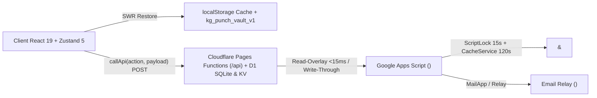
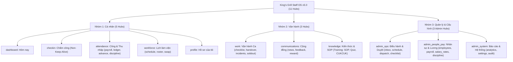
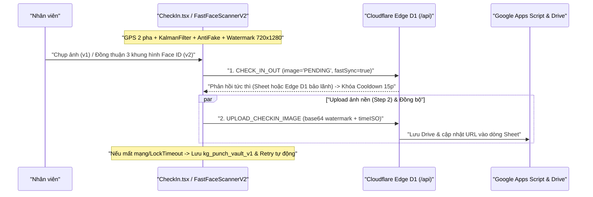

# BẢN ĐẶC TẢ TỔNG THỂ WEBAPP & TÁI THIẾT KẾ UI/UX — KING'S GRILL STAFF OS (v5.0)

> **Phiên bản hệ thống:** `v5.0` (`Unified Staff OS 5.0` • phát hành `19/11/2026`)
> **Mục đích tài liệu:** Cung cấp bản mô tả kiến trúc giao diện, ngữ cảnh nghiệp vụ, hệ thống thiết kế (Design System), toàn bộ 11 Hub chức năng, chi tiết từng màn hình/thành phần, điểm nghẽn UX thực tế và danh sách bất biến bắt buộc bảo toàn để làm đầu vào cho **ChatGPT** thiết kế lại giao diện đẹp mắt, hiện đại và tối ưu thao tác hơn.
> **Phạm vi dữ liệu:** 100% đối chiếu trực tiếp từ mã nguồn `src/`, `functions/`, `gas/`, `migrations/`, `DESIGN.md` và `.design-dna/dna.json`. Mọi khóa bí mật, ID hạ tầng, URL triển khai riêng và thông tin nhạy cảm đã được thay bằng placeholder an toàn.

---

## Mục 0: Hướng Dẫn Sử Dụng Cho ChatGPT & Prompt Mẫu Sẵn Dùng

### 0.1. Bối cảnh Brief dành cho ChatGPT
Khi đọc tài liệu này, bạn (ChatGPT) đóng vai trò **Principal Product Designer & Staff Frontend Architect** chuyên về **Mobile-First Super-App F&B Operations** (React 19 + TypeScript + Tailwind CSS v3.4 + Zustand 5 + Lucide Icons).

Nhiệm vụ của bạn là giúp tôi **tái thiết kế toàn diện giao diện (UI/UX Redesign)** cho ứng dụng **King's Grill Staff OS (v5.0)** sao cho:
1. **Thẩm mỹ vượt trội, hiện đại, rõ phân cấp thị giác** — thoát khỏi cảm giác dồn nén nhiều banner/card/thẻ trạng thái chồng lên nhau.
2. **Tối ưu tốc độ thao tác thực địa** — giảm số lần chạm trên điện thoại tại quầy/bếp/cửa quán (`≥ 44×44px` touch target) và nâng mật độ thông tin thông minh trên Desktop/Tablet (`≥ 1024px`).
3. **Giải quyết dứt điểm danh sách lỗi & điểm nghẽn UX có thực ở Mục 11**.
4. **Không làm gãy bất kỳ luồng nghiệp vụ, API RPC, khóa lưu trữ, quy tắc tính lương/công/két tiền hay selector DOM (`#id` / `data-testid`) nào ở Mục 12**.

### 0.2. Prompt Mẫu Copy-Paste Vào ChatGPT

```text
Tôi đính kèm file WEBAPP_UI_REDESIGN_MASTER_SPEC.md mô tả toàn bộ WebApp "King's Grill Staff OS (v5.0)" hiện tại.

Hãy đóng vai Principal Product Designer & Staff Frontend Architect, nghiên cứu kỹ toàn bộ file đính kèm và thực hiện lần lượt theo yêu cầu của tôi:

1. Đề xuất 3 định hướng thiết kế (Design Directions) khác biệt rõ rệt về bố cục, nhịp thị giác, hệ màu (Light + Dark WCAG 2.2 AA) và điều hướng cho môi trường nhà hàng F&B (Mobile 360-430px dùng 1 tay, Tablet iPad 768px, Desktop >= 1024px), giữ font Be Vietnam Pro + JetBrains Mono (tabular-nums).
2. Thiết kế lại toàn bộ cấu trúc Navigation Shell (Mobile + Tablet + Desktop) và hệ Design Tokens + Component Primitives.
3. Lập phương án tái thiết kế chi tiết cho các màn hình trọng yếu (ưu tiên giải quyết các vấn đề P0-P2 ở Mục 11):
   - Login & Kiosk Chấm công nhanh (v2)
   - Dashboard (Nhân viên & Quản lý)
   - CheckIn (v1 + v2 + FaceEnrollment + MissedCheckInModal)
   - AttendanceLedger & Payroll (Slip + Manager + MonthlySalary)
   - Schedule, Roster & SwapShift
   - WorkHub (Checklist 4 khu, Handover đối soát két, IncidentTracker, SoldOut)
   - AdminApprovalInbox (CashAuditPanel, IncidentCenterPanel) & AdminOperations & HrList & AdminSettingsUnified
4. BẮT BUỘC tuân thủ 100% các ràng buộc tại Mục 12:
   - Không đổi tên bất kỳ API action, payload, localStorage/sessionStorage key, custom event hay tab/sub-tab ID nào.
   - Giữ nguyên 100% toàn bộ DOM `#id` và `data-testid` đã liệt kê.
   - Không dùng thư viện nặng bị cấm (sweetalert2, framer-motion, face-api.js, canvas-confetti); CSS transition <= 200ms.
   - Mọi input/select/textarea trên mobile giữ >= 16px (text-base sm:text-sm) chống iOS Safari zoom.

Trước tiên, hãy tóm tắt nhanh bạn đã nắm được kiến trúc 11-Hub và các bất biến lõi, sau đó đề xuất 3 phương án Design Direction kèm bảng so sánh để tôi chọn trước khi sinh code từng màn hình.
```

---

## Mục 1: Tổng Quan Sản Phẩm, Bối Cảnh Thực Tế Nhà Hàng & Personas / RBAC

### 1.1. Định vị sản phẩm
**King's Grill Staff OS (`v5.0`)** là hệ điều hành nội bộ tất-cả-trong-một (Super-App) cho chuỗi/nhà hàng nướng **King's Grill**, kết hợp:
- **Chấm công sinh trắc học & GPS chống gian lận** (AI Face Recognition 5 góc trên thiết bị + Kiosk dùng chung + Geofence `≤ 25m` + lọc nhiễu Kalman + chống Fake GPS).
- **Quản lý lịch làm việc & đổi ca thông minh** (đăng ký ca tuần bắt buộc trước 17:00 Thứ Bảy, lịch tổng ma trận tháng, chợ đổi ca 2 bước có kiểm tra trùng ca & ngưỡng tăng ca).
- **Vận hành ca F&B thời gian thực** (Checklist 4 khu vực đồng bộ đa nhân viên + lưu nháp ngoại tuyến, Bàn giao & Đối soát két tiền mặt 2 chiều theo POS CUKCUK, Theo dõi Sự cố 4 bước, Bảng Món hết 86).
- **Công, Lương & Tài chính minh bạch** (Chu kỳ ngày công `06:00 → 05:59` hỗ trợ ca đêm, tăng ca sau `00:15`, xác nhận phiếu lương 4 bước, ứng lương theo `%` hạn mức tự động, thưởng/phạt, xuất CSV chuyển khoản ngân hàng chuẩn NAPAS & in phiếu lương A5).
- **Cộng đồng, Gamification & Đào tạo SOP** (Bảng tin nội bộ, Góp ý ẩn danh 100%, Ví King Coins & Bảng vàng tích cực, Sổ tay SOP 13 mục, Trắc nghiệm đảo đáp án chống học vẹt, Hướng dẫn POS CUKCUK 28 bước ảnh).
- **Trung tâm Điều hành & Quản trị** (Hộp duyệt 1 chạm gom 6 hàng chờ, Điều phối nhóm trực & cân bằng năng lực nhân sự, Hồ sơ nhân sự, Thống kê 30 ngày, Cài đặt hệ thống/AI bảo vệ bằng Master PIN, Nhật ký kiểm toán Audit Log).

### 1.2. Đặc thù môi trường sử dụng thực tế (Rất quan trọng khi thiết kế UI)
- **Múi giờ & Chu kỳ ca đêm:** Toàn bộ hệ thống hoạt động theo múi giờ Việt Nam (`Asia/Ho_Chi_Minh`, `UTC+7`). Nhà hàng phục vụ buổi chiều–tối–khuya nên một ngày công được tính từ **`06:00` hôm nay đến `05:59:59` sáng hôm sau**. Mọi lượt chấm công trước `06:00` sáng đều thuộc về chu kỳ ca của ngày hôm trước.
- **Thiết bị & Mạng:** Nhân viên chủ yếu dùng **điện thoại cá nhân (iOS Safari PWA / Android Chrome)** trên mạng 4G/Wi-Fi quán, thường thao tác bằng **1 tay**, đôi khi tay ướt hoặc trong điều kiện ánh sáng khu bếp/quầy bar/sảnh tối. Khu vực cửa ra vào có thể đặt **máy Kiosk dùng chung** chạy chế độ Face ID v2 không cần đăng nhập.
- **Tác vụ Quản lý trên Desktop & Tablet:** Quản lý/Chủ quán dùng **Laptop/PC (`≥ 1024px–1920px`)** hoặc **iPad (`768px–1023px`)** để duyệt hàng chờ, xếp ca ma trận tuần/tháng, đối soát két tiền mặt, tính lương và kiểm tra audit log.
- **Chống WebView mạng xã hội:** Trình duyệt nhúng bên trong Zalo/Messenger chặn camera WebRTC và GPS chính xác; ứng dụng có cổng chặn bắt buộc chuyển sang Safari/Chrome (`ZaloWarning.tsx`).

### 1.3. Personas, Phân Quyền (RBAC) & Vòng Đời Nhân Sự
Mọi logic phân quyền tập trung tại `src/utils/permissions.ts` (`isAdminUser`, `hasTabPermission`) và `src/utils/employment.ts` (`isWorkEligible`):

| Nhóm / Vai trò / Chức vụ | Quy tắc nhận diện trong code | Quyền truy cập & Giao diện đặc thù |
|---|---|---|
| **Admin (Quản lý / Chủ quán)** | `user?.role === 'admin'` (`isAdminUser(user) === true`) | Toàn quyền tất cả **11 Hub** (gồm 3 Hub Quản trị `admin_ops`, `admin_people_pay`, `admin_system`), không bị giới hạn 15 phút cooldown chấm công, không bị khóa cổng đăng ký lịch T5–T7, được mở khóa Master PIN AI Keys, được đăng ký hộ Face ID cho nhân viên, xem toàn quán trên `AttendanceLedger`, `Payroll`, `Schedule`, `Advance`, `Discipline`, `Feedback`, `NewsFeed` (đăng tin). |
| **Tester** | `user?.role === 'tester'` | **Cố ý KHÔNG có quyền Admin** (`isAdminUser` trả về `false`). Bị chặn hoàn toàn 3 Hub `admin_*`. Được phép xem Lịch tổng tháng toàn quán trên `Roster` (cùng quyền xem tháng như Admin) và bỏ qua kiểm tra bán kính GPS `≤ 25m` khi test chấm công. |
| **F&B Vận hành cốt lõi** | `role === 'user'` + vị trí: `Phục vụ`, `Tổ trưởng`, `Quản lý`, `Thu ngân`, `Bếp`, `Pha chế` | Truy cập **8 Hub nhân sự**. Lưu ý: `Quản lý` (vị trí), `Tổ trưởng`, `Thu ngân`, `Bếp`, `Pha chế` được vào `handover` & `incidents`; **`Phục vụ` bị chặn `handover` & `incidents`** trong `permissions.ts` nhưng được vào `soldout` & `training`. |
| **Hậu cần** | `role === 'user'` + vị trí: `Tạp vụ`, `Bảo vệ` | Chỉ dùng nhóm Cá nhân, `checklist`, Cộng đồng (`news`, `feedback`, `reward`) và `knowledge` (chú ý: `KnowledgeHub` render trực tiếp `Training` ở tab `knowledge`, trong khi alias lá `soldout`, `handover`, `incidents`, `training` bị `hasTabPermission` chặn đối với `Tạp vụ`/`Bảo vệ`). |
| **4 Trạng thái vòng đời nhân sự (`employmentStatus`)** | `active`, `leave`, `suspended`, `resigned` | Chỉ `active` mới `isWorkEligible === true`. Nhân sự ở trạng thái `leave` (Tạm nghỉ), `suspended` (Đình chỉ), `resigned` (Đã nghỉ việc) sẽ bị chặn thao tác và hiển thị thẻ `<EmploymentStatusNotice />` tại `CheckIn`, `Schedule`, `Checklist`, `Handover`, `IncidentTracker`, đồng thời bị ẩn khỏi danh sách phân công/chọn thưởng phạt/đổi ca. |

---

## Mục 2: Tech Stack, Kiến Trúc Frontend–Edge–GAS & Ràng Buộc Kỹ Thuật Ảnh Hưởng UI

### 2.1. Thư viện & Chính sách tối ưu gói (`package.json` & `vite.config.ts`)
- **Core Stack:** `react` `^19.2.4`, `react-dom` `^19.2.4`, `typescript` `~6.0.2`, `vite` `^5.4.0`, `tailwindcss` `^3.4.19`, `zustand` `^5.0.12`, `lucide-react` `^1.7.0`.
- **Biometrics (Lazy-loaded, tách chunk riêng `face-v2-biometrics`):**
  - `@mediapipe/tasks-vision` `^1.2.0` (478-landmark 3D FaceLandmarker).
  - `onnxruntime-web` `^1.31.1` (WASM SIMD chạy `w600k_mbf.onnx` ArcFace 512-D + `minifasnet_v2.onnx` chống giả mạo ảnh/màn hình).
  - Cache vector khuôn mặt (`src/utils/faceProfileCache.ts`) tách biệt **zero-WASM** để trang `Login` và Desktop Admin tải tức thì không kéo runtime AI nặng.
- **Chính sách Zero Heavy Legacy Libs (Bắt buộc giữ nguyên):**
  - Đã gỡ bỏ hoàn toàn `sweetalert2`, `framer-motion`, `face-api.js`, `canvas-confetti` (giảm **-21.9 MB** gói triển khai).
  - **Không dùng** bất kỳ thư viện modal/animation nặng bên ngoài nào; mọi Toast/Confirm/Alert/Loading chạy qua `useFeedbackStore` + `KgFeedbackHost`; mọi chuyển động dùng CSS thuần `<= 200ms`.

### 2.2. Kiến trúc dữ liệu 3 tầng & Đồng bộ bền bỉ


- **Failover & Caching (`src/services/api.ts`):** Mọi lời gọi `callApi(action, payload, options)` gửi HTTP `POST` (Content-Type `text/plain;charset=utf-8` để tránh CORS preflight khi gọi GAS). Trên production, nếu `/api` lỗi hoặc chưa hỗ trợ action mới, client tự fallback sang `<PRIMARY_EDGE_API_URL>`. Read actions (`GET_*`, `GEOCODE`) được dedupe in-flight và cache trong `sessionStorage` (`GET_DATA`: 5 phút; `GET_NOTIFICATIONS`/`GET_POSTS`: 30 giây; mặc định: 2 phút). Mutation tự hủy cache theo prefix đích danh (`MUTATION_INVALIDATION_PREFIXES`).
- **Stale-While-Revalidate (`src/utils/refreshData.ts`):** Khi mở app, `restoreFromCache()` phục hồi ngay snapshot `kg_app_cache_v2` lên UI để render 0ms, sau đó `refreshAppData()` đồng bộ nền (ngưỡng stale 5 phút, lặp lại mỗi 5 phút).
- **Zero-Loss Offline Punch Vault (`src/utils/offlineQueue.ts`):** Mọi lượt chấm công được lưu vào `kg_punch_vault_v1` trước/song song khi gửi mạng. Nếu mất mạng, lock timeout hoặc tắt màn hình iOS giữa chừng, bản ghi nằm trong `kg_offline_queue_v1` + `SyncVaultDrawer.tsx` để tự đồng bộ hoặc cho phép người dùng bấm Thử lại/Xóa thủ công.

### 2.3. Ràng buộc PWA, iOS Safari & Âm thanh đa tầng
- **Chống iOS Auto-Zoom:** Trong `src/index.css`, `@media screen and (max-width: 768px)` ép `font-size: 16px` (`text-base sm:text-sm`) cho toàn bộ `input`, `select`, `textarea` (trừ checkbox/radio/range). Giao diện mới **bắt buộc giữ nguyên** quy tắc này.
- **Khung nhìn di động & Safe Area:** Dùng `min-h-dvh` / `h-dvh`, `pt-safe-top` (`max(0.75rem, env(safe-area-inset-top))`), `pb-safe` (`max(0.875rem, env(safe-area-inset-bottom))`), khóa tràn ngang bằng `overflow-x: clip`.
- **Service Worker (`public/sw.js`, cache `kg-staff-os-v16`):** HTML dùng `Network-First`; tài nguyên tĩnh (`/assets/`, `/models/`, `/audio/`, `/hdsd-cukcuk/`) dùng `Cache-First`; tuyệt đối bỏ qua `/api`.
- **Hệ thống âm thanh 3 tầng (`src/utils/soundEffects.ts`):** Mở khóa Web Audio trên chạm đầu tiên (`setupAudioUnlock` cho iOS WebKit) + 13 file MP3 studio trong `public/audio/` + Web Speech API có **rào chắn khóa giọng ngoại ngữ (`speakWithVietnameseLock`)** tuyệt đối không đọc tiếng Việt bằng giọng tiếng Anh nếu máy thiếu voice `vi`.

---

## Mục 3: Hệ Thống Thiết Kế Hiện Tại (Design System v5.0 — Warm Hospitality)

### 3.1. Bảng Token Màu Sắc (`src/index.css`, `tailwind.config.js`, `DESIGN.md`)
Hệ thống hỗ trợ đầy đủ **Light Mode** (`:root`, `[data-theme="light"]`) và **Dark Mode** (`.dark`, `[data-theme="dark"]`), gắn vào utility Tailwind dưới namespace `kg.*` (VD: `bg-kg-surface`, `text-kg-text`).

| Token CSS | Light Mode (Warm Alabaster) | Dark Mode (Deep Obsidian) | Vai trò & Quy tắc tương phản WCAG 2.2 AA |
|---|---|---|---|
| `--kg-bg` (`--bg`) | `#f4f0e8` | `#0d1015` | Nền canvas chính toàn ứng dụng |
| `--kg-surface` (`--surface`) | `#fffdf9` | `#161a22` | Nền thẻ (`KgCard`), header, sheet, bảng |
| `--kg-surface-soft` (`--surface-warm`) | `#eae3d7` | `#1f2530` | Nền phụ lõm, ô input mặc định, header bảng |
| `--kg-border` / `--kg-border-strong` | `#ddd4c5` / `#c4b8a5` | `rgba(245,240,232,0.12)` / `0.22` | Viền 1px tách lớp bề mặt (hạn chế đổ bóng nặng) |
| `--kg-text` (`--fg`) | `#1a1613` | `#f7f4ee` | Chữ chính (độ tương phản cao trên mọi nền) |
| `--kg-text-muted` / `--kg-text-soft` | `#5c5349` / `#6e6459` | `#b5afa6` / `#969087` | Chữ phụ, mô tả, metadata, placeholder |
| `--kg-primary` / `--kg-primary-hover` | `#0b253c` / `#123656` | `#2563eb` / `#3b82f6` | Nút hành động chính (Midnight Navy / Cobalt), chữ trắng `#ffffff` |
| `--kg-primary-ink` / `--kg-primary-soft` | `#0b253c` / `rgba(11,37,60,0.09)` | `#7fb3ff` / `rgba(59,130,246,0.16)` | Màu chữ/icon mang nghĩa primary trên nền sáng/tối (`≥ 8.4:1`) |
| `--kg-accent` / `--kg-accent-ink` / `-soft` | `#c8432b` / `#b33620` / `#fdede8` | `#e05238` / `#ff8a73` / `rgba(224,82,56,0.16)` | Tín hiệu thương hiệu Grill Ember (CTA nóng, tab active trên rail) |
| `--kg-rail-bg` / `--kg-rail-text` / `-muted` | `#0b1f33` / `#f4f0e8` / `#9fb2c7` | `#10141c` / `#f7f4ee` / `#9da6b5` | Nền thanh điều hướng trái Desktop, Floating Dock Mobile & Hero Card |
| `--kg-success` / `-soft` | `#15803d` / `#ecfdf3` | `#34d399` / `rgba(52,211,153,0.14)` | Trạng thái hợp lệ, đã duyệt, hoàn thành |
| `--kg-warning` / `-soft` | `#b45309` / `#fef7e6` | `#fbbf24` / `rgba(251,191,36,0.14)` | Cảnh báo, chờ duyệt (**Nền solid trong `.dark` BẮT BUỘC chữ `#1A1613`**) |
| `--kg-danger` / `-soft` | `#dc2626` / `#fef1f1` | `#f87171` / `rgba(248,113,113,0.14)` | Lỗi, vi phạm, sự cố (**Nền solid trong `.dark` BẮT BUỘC chữ `#0D1015`**) |
| `--kg-info` / `-soft` | `#0369a1` / `#edf7fe` | `#38bdf8` / `rgba(56,189,248,0.14)` | Thông tin, bảo lãnh đám mây Edge D1 |

> **Chú ý thiết kế:** Không dùng glassmorphism trang trí cho thẻ nội dung; phong cách hiện tại hướng tới **tactile porcelain/basalt cards** (`border: 1px`, radius `12px–16px`, `--shadow-card` nhẹ). Khi chuyển sang Dark Mode, mọi badge/nút solid dùng `--kg-accent`, `--kg-warning`, `--kg-danger` bắt buộc chuyển màu chữ sang mực tối (`#0D1015` / `#1A1613`) để đạt contrast ≥ 4.5:1.

### 3.2. Typography, Spacing & Motion
- **Font chữ (`index.html` + `tailwind.config.js`):**
  - `font-sans`: `'Be Vietnam Pro'` (hỗ trợ đầy đủ dấu tiếng Việt).
  - `font-mono`: `'JetBrains Mono'` + bắt buộc class `font-mono tabular-nums` cho **toàn bộ tiền tệ VNĐ, giờ làm việc, ngày tháng, bộ đếm, phần trăm và King Coins**, căn phải trong các cột bảng tài chính.
- **Thang kích thước (`.design-dna/dna.json`):** Display `1.5rem` (800), H1 `1.25rem` (700), H2 `1rem` (700), Body `0.875rem` (400), Caption `0.75rem` (500), Numeric Metric `1.375rem` (700, `tabular-nums`).
- **Spacing & Radii:** Base unit `4px` (`[4, 8, 12, 16, 20, 24, 32, 48, 64]`), chiều cao dòng chuẩn desktop `40px`, `--radius-md: 12px`, `--radius-lg: 16px`, `--kg-control-height: 42px`. Trên `< 640px`, quy tắc **Zero Double-Padding** tự động triệt tiêu padding ngang lồng nhau của `.kg-workspace-stage > .p-4` / `.kg-hub-panel > .p-4`.
- **Chuyển động (`<= 200ms`):** `--motion-fast: 140ms`, `--motion-base: 180ms`, easing `cubic-bezier(0.22, 1, 0.36, 1)`. Bắt buộc tôn trọng `@media (prefers-reduced-motion: reduce)`.

### 3.3. Danh mục Component Nguyên Thủy (`KgDesignSystem.tsx` & `KgFeedbackHost.tsx`)
Toàn bộ các trang tái sử dụng bộ primitives sau (yêu cầu đủ 9 trạng thái: `default`, `hover`, `focus-visible`, `active`, `selected`, `disabled`, `loading`, `empty`, `error`):
- **Layout:** `KgPage` (`max-w-[1360px]` hoặc `wide: 1520px`), `KgSection`, `KgPageHeader`, `KgModuleHero` (thẻ đầu trang có vạch màu nhấn bên trái `--kg-accent`, badge eyebrow, tối đa 2 feature chips trên `sm+`, nút `Mẹo & Lưu ý` hoặc icon `?` trên mobile, và slot `actions`).
- **Surfaces & KPI:** `KgCard` (hỗ trợ `onClick` với `role="button"`, `tabIndex={0}`, `Enter`/`Space`, `data-selected`), `KgMetricCard` (title, numeric value `tabular-nums`, icon box theo variant `success|warning|error|info`, subtext), `KgAlertCard`, `KgStatusBadge` (`success|warning|error|info|neutral`).
- **Form Controls:** `KgInput` (icon trái, `rightAdornment`, error/hint, `min-h-[44px] sm:min-h-[42px]`), `KgSelect`, `KgTextarea`, `KgButton` (5 variants `primary|secondary|danger|warning|ghost`, 3 sizes `sm|md|lg`, tự động `aria-busy` & spinner khi `loading`), `KgIconButton` (`44×44px` mobile, `40×40px` `sm+`).
- **Feedback & States:** `KgSkeleton`, `KgEmptyState`, `KgErrorState`, `KgSyncStatus` (hiển thị Online/Offline, số mục chờ đồng bộ, giờ đồng bộ cuối và nút quay làm mới), `KgFeatureTip` (popover/sheet hướng dẫn từng phân hệ).
- **Overlays & Global Feedback:** `KgBottomSheet` (mobile trượt từ dưới lên `rounded-t-2xl max-h-[90dvh]`, desktop căn giữa `max-w-lg rounded-2xl`, tích hợp `useDialogA11y` focus-trap + Escape), `KgConfirmSheet`, `KgActionSheet` (lưới 3 cột phân nhóm dùng cho nút Menu di động), và `KgFeedbackHost` (cung cấp `kgToast()`, `kgConfirm()`, `kgAlert()`, `kgLoading()` thay thế 100% `sweetalert2`).

### 3.4. Thang Z-Index & Hàng Đợi Modal Khởi Động (`src/utils/modalQueue.ts`)
Hệ thống điều phối lớp phủ theo thang Z-Index chặt chẽ để không bao giờ bị đè hoặc bật nhiều modal cùng lúc lúc mới mở app:

| Tầng lớp (Layer) | Z-Index | Thành phần / Vai trò |
|---|---|---|
| Sub-tabs & Thanh Bulk Sticky | `z-20` – `z-30` | `ModuleHub` sticky sub-tabs (`md:top-[60px]`), `HrList` sticky bulk bar (`md:top-[124px]`), thanh đồng bộ nổi `Checklist` & `AdminOperations` |
| Shell Navigation & Floating AI Closed | `z-40` – `z-[85]` | Mobile Header (`z-40`), Mobile Floating Pill Dock (`z-50`), Nút AssistiveTouch AI khi thu gọn (`z-[85]`, tự hạ xuống `z-40` nếu có `#cukcuk-lightbox`) |
| Bottom Sheets, Command Palette & Lightbox | `z-[10050]` – `z-[10055]` | `KgBottomSheet`, `KgConfirmSheet`, `KgActionSheet`, `KgCommandPalette` (`z-[10055]`), `AIAssistant` chat panel (`z-[10055]`), `CukcukGuideLightbox` (`z-[10055]`) |
| Startup Modal Priority 1 | `z-[10060]` | `NewbieGuideModal` (`newbie_guide`) |
| Startup Modal Priority 2 | `z-[10070]` | `VersionReleaseModal` (`version_release` — tự ẩn nếu đang ở tab `checkin`) & `FastFaceScannerV2` |
| Kiosk / Operational Full-Screen Modals | `z-[10075]` | `AdminStaffFacePickerModal` & `MissedCheckInModal` |
| Startup Modal Priority 3 & Face Enroll | `z-[10080]` | `MandatoryScheduleModal` (`mandatory_schedule` — không cho đóng T5–T7 `<17:00`) & `FaceEnrollmentModal` |
| Full-Screen Photo Lightbox | `z-[10090]` | `ImagePreview` (xem ảnh chấm công HD) |
| Undo Floating Bar & Global Feedback | `z-[10140]` – `z-[10210]` | Thanh hoàn tác `SoldOut` (`z-[10140]`), `KgFeedbackHost` Toast (`z-[10150]`), Confirm/Alert (`z-[10180]`), Loading Overlay (`z-[10210]`) |
| Startup Modal Priority 4 (Cao nhất) | `z-[10300]` | `ZaloWarning` (cổng chặn trình duyệt nhúng Zalo/Messenger) |

### 3.5. Quy chuẩn Responsive Breakpoints
- **Mobile (`< 640px` / `360–430px`):** Nút và tab tối thiểu `44×44px` (`min-h-[44px]`), điều hướng qua Top Header 1 hàng + Floating Pill Dock đáy nổi, ẩn `KgModuleHero` trên một số trang camera (`CheckIn`) để camera nằm ngay vùng nhìn đầu tiên, triệt tiêu padding ngang lồng nhau.
- **Tablet (`768px–1023px` / `md` → `< lg`):** Hiển thị **Compact Icon+Micro-Label Rail (`76px`)** bên trái thay cho Floating Dock dưới đáy.
- **Chuyển đổi Bảng ↔ Thẻ tại `lg` (`1024px`):** Mọi bảng dữ liệu dày đặc (`AttendanceLedger`, `PayrollManagerView`, `MonthlySalaryManager`, `HrList`, `AdminChecklistConfig`, `AdminAuditLog`, `Handover`, `Advance`, `Discipline`) **bắt buộc** chuyển thành dạng thẻ (Card list) ở `< 1024px` (`< lg`) để iPad dọc và điện thoại không bao giờ bị tràn ngang.
- **Laptop / Desktop (`>= 1280px` / `xl`):** Sidebar trái mặc định mở rộng `232px` (có nút thu gọn về `76px`), vùng nội dung tối đa `1520px` (Hub rộng) hoặc `1260px` (Hub tập trung).

---

## Mục 4: Kiến Trúc Thông Tin 11-Hub, Khung Ứng Dụng (`KgAppShell`) & Lớp Phủ Toàn Cục

### 4.1. Sơ đồ Kiến trúc Thông Tin 11-Hub (Consolidated Super-App IA)



### 4.2. Bảng định tuyến & tương thích ngược (`moduleRegistry.ts`, `ModuleHubs.tsx`, `useAppStore.ts`)

| Hub ID (`TabId`) | Nhãn (Desktop / Mobile ngắn) | Nhóm | Sub-tabs (`?tab=&sub=`) | Phân quyền & Ghi chú kỹ thuật |
|---|---|---|---|---|
| `dashboard` | `Hôm nay` / `Hôm nay` | Cá nhân | *(Cấp 1)* | Mọi user. Tự render `EmployeeDashboardView` hoặc `AdminDashboardView`. |
| `checkin` | `Chấm công` / `Chấm công` | Cá nhân | *(Cấp 1)* | Mọi user `active`. **Không Keep-Alive** trong `Dashboard.tsx` để giải phóng camera sạch sẽ khi chuyển tab. |
| `attendance` | `Công & Thu nhập` / `Công lương` | Cá nhân | `payroll` (Phiếu lương), `ledger` (Bảng công & Nhật ký), `advance` (Ứng lương), `discipline` (Kỷ luật) | Mọi user. Alias: `timesheet`, `history` → `ledger`. Tự prefetch `GET_PAYROLL` & `GET_TIMESHEET`. |
| `workforce` | `Lịch làm việc` / `Lịch ca` | Cá nhân | `schedule` (Lịch của tôi), `roster` (Lịch tổng), `swap` (Đổi ca) | Mọi user. Tự prefetch `GET_MONTH_SCHEDULES` & `GET_SWAP_REQUESTS`. |
| `profile` | `Hồ sơ của tôi` / `Hồ sơ` | Cá nhân | *(Cấp 1)* | Mọi user. Chỉ đọc hồ sơ, trạng thái việc làm, Face ID & quyền. |
| `work` | `Vận hành Ca` / `Vận hành` | Vận hành | `checklist` (Checklist phân khu), `handover` (Bàn giao ca), `incidents` (Sự cố ca), `soldout` (Món hết) | Có `summaryStrip` sống đếm **Món hết** & **Sự cố mở**. Sub-tab lọc theo `position` trong `permissions.ts`. |
| `communications` | `Cộng đồng` / `Cộng đồng` | Vận hành | `news` (Bảng tin), `feedback` (Góp ý), `reward` (Ghi nhận & Coins) | Mọi user. Legacy `income` & `reward` trỏ về đây. |
| `knowledge` | `Kiến thức & SOP` / `SOP` | Vận hành | *(Render thẳng `Training.tsx` với 3 tab nội bộ: `sop`, `quiz`, `cukcuk`)* | Legacy `training`, `guide` trỏ về đây. |
| `admin_ops` | `Điều hành & Duyệt` / `Điều hành` | Quản lý & Cấu hình | `inbox` (Hộp duyệt), `schedule` (Xếp lịch), `dispatch` (Điều phối), `checklist` (Checklist) | Chỉ `admin`. Alias `operations` → `dispatch`, `settings` → `inbox`. |
| `admin_people_pay` | `Nhân sự & Lương` / `Nhân sự` | Quản lý & Cấu hình | `employees` (Hồ sơ nhân sự), `payroll` (Bảng lương), `salary_rates` (Đơn giá lương), `discipline` (Kỷ luật) | Chỉ `admin`. Alias `config` → `salary_rates`, `organization` → `employees`, `advance` → `payroll`. |
| `admin_system` | `Báo cáo & Hệ thống` / `Hệ thống` | Quản lý & Cấu hình | `analytics` (Báo cáo), `settings` (Cấu hình & AI), `audit` (Nhật ký kiểm toán) | Chỉ `admin`. Alias `ai`, `organization`, `admin` → `settings`. |

- **Cơ chế Keep-Alive & Deep-Link:** `Dashboard.tsx` giữ tối đa `3` Hub đã mở gần nhất (`MAX_KEEP_ALIVE_TABS = 3`, trừ `checkin`) và `ModuleHub` giữ tối đa `2` sub-tab (`MAX_KEEP_ALIVE_SUBTABS = 2`). Trạng thái đồng bộ URL `?tab=&sub=`, `sessionStorage['kg_hub_subtab_{hubId}']`, và sự kiện `window` `kg:subtab-select` / `kg:subtab-changed`. Mọi đường dẫn cũ (`schedule`, `timesheet`, `history`, `hr_list`, `admin_org`, `admin_payroll`...) được chuyển hướng qua `TAB_ALIAS_MAP`.

### 4.3. Khung Ứng Dụng Chính (`src/components/KgAppShell.tsx`)
1. **Mobile Super-App Header (`< 768px`, `sticky top-0 z-40 min-h-[56px]`):**
   - Trái: Nút logo King's Grill (về `dashboard`) + vùng chạm mở `SyncVaultDrawer` hiển thị tiêu đề phân hệ hiện tại (`activeTitle`), badge phiên bản (`sm:`), chấm trạng thái kết nối (`SyncDot`: đỏ nếu mất mạng/lỗi Vault, vàng nếu có hàng đợi, xanh dương nhấp nháy khi đang sync, xanh lá khi ổn định) và dòng phụ `{shiftName} • {Tên ngắn} • {Vị trí/Quản lý}`.
   - Phải: Pill `KgSyncStatus` (`sm:`), nút Kính lúp mở `KgCommandPalette`, **duy nhất 1** `<NotificationBell />` khi ở Mobile, và nút Avatar/Chữ cái đầu mở **Mobile Account Sheet**.
2. **Mobile Floating Pill Dock (`< 768px`, `fixed bottom z-50 bg-[var(--kg-rail-bg)]`):**
   - 5 ô chạm ngang `min-h-[48px]`, nhãn 1 dòng không xuống dòng:
     - **Nhân viên:** `Hôm nay` (`dashboard`), `Chấm công` (`checkin`), `Vận hành` (`work`), `Lịch ca` (`workforce`), và nút `Menu` (mở `KgActionSheet` chứa các Hub còn lại theo nhóm).
     - **Admin:** `Hôm nay` (`dashboard`), `Chấm công` (`checkin`), `Điều hành` (`admin_ops`), `Nhân sự` (`admin_people_pay`), và nút `Menu`.
3. **Mobile Account & Quick Preferences Sheet (`KgBottomSheet`):**
   - Thẻ thông tin nhân sự (`fullname`, `@username`, icon khiên Admin nếu là quản lý, `Ca hiện tại`).
   - 4 dòng thao tác: `Thông tin phiên bản & Điểm mới` (badge `v5.0`), `Hồ sơ cá nhân & Mật khẩu` (nhảy `profile`), `Cẩm nang hướng dẫn người mới`, `Giao diện hiển thị` (toggle `Chế độ Sáng`/`Chế độ Tối`), và nút `Đăng xuất tài khoản` màu đỏ.
4. **Desktop & Tablet Architectural Midnight Rail (`>= 768px`, `bg-[var(--kg-rail-bg)]`):**
   - **Tablet (`768px–1279px`):** Mặc định thu gọn `76px` dạng Icon + Micro-label (`shortLabel`), có nút mở rộng trên đầu rail.
   - **Desktop (`>= 1280px`):** Mặc định mở rộng `232px` (lưu lựa chọn vào `localStorage['kg_rail_expanded_v4']`), chia 3 nhóm `Cá nhân`, `Vận hành`, `Quản lý & Cấu hình`, tab đang chọn tô màu `--kg-accent`.
   - Đáy rail: 3 nút tiện ích — `Cẩm nang hướng dẫn người mới` (`GraduationCap`), chuyển Light/Dark (`Sun`/`Moon`), `Đăng xuất tài khoản` (`Power`).
5. **Desktop Editorial Masthead (`>= 768px`, `h-[60px] sticky top-0 z-30`):**
   - Trái: Nhãn nhóm (`2xl:`), tiêu đề trang (`activeTitle`), `<KgVersionBadge showCodename />`.
   - Phải: Nút `Tìm phân hệ, thao tác...` kèm phím tắt `Ctrl K`, `renderSyncPill()` (bấm mở `SyncVaultDrawer`, hiện badge `!{N}` nếu có lỗi Vault), pill `Ca: Ca Sáng / Ca Tối`, **duy nhất 1** `<NotificationBell />` khi ở Desktop, và nút Avatar/Tên nhảy tới `profile`.

### 4.4. Toàn bộ 9 Thành Phần Toàn Cục & Overlays
1. **`AIAssistant.tsx` (Trợ lý AI Nút Home Ảo AssistiveTouch):**
   - *Khi đóng:* Nút tròn `44×44px` kéo thả tự do (`touch-none`), hút nam châm về mép trái/phải và lưu vị trí `localStorage['kg_ai_assistive_pos_v4']`; tự thu gọn bán phần vào mép màn hình sau `2.4s` rảnh; **tự ẩn hoàn toàn khi ở tab `checkin`**.
   - *Khi mở (`z-[10055]`):* Mobile dạng Bottom Sheet (`78dvh` / `90dvh`), Desktop dạng cửa sổ nổi bám theo mép đã neo (`390×560px` hoặc mở rộng `600px × 80dvh`). Bơm động toàn bộ ngữ cảnh sống (ca hôm nay, bảng công, giờ lương, trạng thái checklist 4 khu, bàn giao két, top-3 SOP liên quan qua `searchSops`, custom system prompts). Chạy 3 tầng fallback: Proxy `AI_CHAT` (`llama-3.3-70b-versatile`) → Groq Key trực tiếp → Gemini 2.5 Flash; lưu lịch sử qua `SAVE_CHAT_LOG`.
2. **`KgCommandPalette.tsx` (`Ctrl+K` / `Cmd+K`, `z-[10055]`):**
   - Tìm kiếm mờ không dấu tiếng Việt (`normalize('NFD')`) qua toàn bộ ~28+ Hub, sub-tab quản lý/nhân viên (tự lọc theo quyền `hasTabPermission`) và 2 thao tác nhanh (`Mở Cẩm nang Nhân sự mới`, `Chuyển sang Giao diện Sáng/Tối`). Hỗ trợ `↑↓`, `Enter`, `Esc`.
3. **`NotificationBell.tsx` (Chuông thông báo đồng bộ):**
   - Singleton state dùng chung toàn app (không bao giờ nhân đôi polling khi đổi breakpoint), tự poll `GET_NOTIFICATIONS` mỗi 2 phút khi tab đang hiển thị. Mở `KgBottomSheet` liệt kê thông báo (`info`, `warning`, `success`, `action`), bấm nhảy trực tiếp deep-link `?tab=&sub=`, nút `Đọc hết ({N})` (`MARK_NOTIFICATION_READ`).
4. **`SyncVaultDrawer.tsx` (Ngăn kéo Vault ngoại tuyến):**
   - Mở khi bấm thanh đồng bộ trên Header. Hiển thị trạng thái mạng + lần sync cuối, danh sách bản ghi lỗi trong `kg_punch_vault_v1` (kèm lý do lỗi từ server, nút `Thử lại`, nút 2 bước `Bỏ qua` → `Xác nhận xóa`), danh sách hàng đợi `kg_offline_queue_v1` (số lần thử `attempts/maxAttempts`), và nút footer `Đồng bộ ngay`.
5. **`VersionReleaseModal.tsx` (`z-[10070]`, Priority `2`):**
   - Tự mở **1 lần duy nhất** khi user vào v5.0 (kiểm tra `kg_seen_release_v5_0`, không làm phiền nếu đang ở tab `checkin` hoặc URL có `?quietRelease=1`). Có 3 tab: `Điểm mới` (4 thẻ số liệu `RELEASE_STATS` + 3 nhóm accordion), `Chi tiết (10)` (lọc `Tất cả`, `Sửa lỗi`, `Thêm mới`, `UI & Mobile`), `Các bản` (timeline `5.0` → `v1.0.0`).
6. **`NewbieGuideModal.tsx` (`z-[10060]`, Priority `1`):**
   - Hướng dẫn 5 bước (1. Chấm công Face ID & GPS, 2. Đăng ký lịch & Đổi ca, 3. Checklist phân khu/Két/Sự cố, 4. Công/Lương/Ứng lương, 5. SOP/CUKCUK/King Coins) kèm nút nhảy thẳng tới phân hệ tương ứng và checkbox `"Không tự động hiển thị lại"`.
7. **`MandatoryScheduleModal.tsx` (`z-[10080]`, Priority `3`):**
   - Cổng chặn **không thể đóng** (`closeOnEscape: false`, không có nút X hay nút Hoãn) xuất hiện từ **Thứ 5 `00:00` → Thứ 7 trước `17:00` GMT+7** đối với nhân viên chưa đăng ký lịch tuần tới. Tự ẩn khi người dùng đang đứng ngay tại trang đăng ký lịch (`schedule`). Nút duy nhất: `ĐĂNG KÝ LỊCH LÀM TUẦN {weekDisplay} NGAY`.
8. **`ZaloWarning.tsx` (`z-[10300]`, Priority `4`):**
   - Phát hiện trình duyệt nhúng Zalo/Messenger/Facebook; khóa toàn màn hình hướng dẫn mở bằng Safari/Chrome, cung cấp link `intent://...com.android.chrome` trên Android và nút `Sao chép đường dẫn chấm công` (`data-testid="zalo-copy-link-btn"`).
9. **`ImagePreview.tsx` (`z-[10090]`):**
   - Lightbox toàn màn hình xem ảnh chấm công (base64 hoặc URL Google Drive tự chuyển đổi giữa `lh3.googleusercontent.com/d/{id}` → `thumbnail` → `iframe` dự phòng). Hỗ trợ Phóng to/Thu nhỏ (`1x–1.8x`), Tải về máy, Mở trên Google Drive, đóng bằng `Esc`.

---

## Mục 5: Đặc Tả Siêu Chi Tiết Nhóm Màn Hình 1 — Xác Thực, Trang Chủ & Chấm Công Sinh Trắc Học

### 5.1. `src/pages/Login.tsx` — Cổng Xác Thực & Trạm Kiosk Face ID v2
- **Mục đích & Ngữ cảnh:** Màn hình đầu tiên khi chưa đăng nhập (`!currentUser`). Hỗ trợ 3 chế độ nội bộ (`login`, `register`, `forgot`) + mở **Trạm Chấm Công Khuôn Mặt Nhanh (Kiosk Mode v2)** ngay không cần đăng nhập tài khoản.
- **Bố cục & Giải phẫu thị giác:**
  - **Header gọn (`h-14`):** Logo King's Grill + chữ `KING'S GRILL / Staff OS` trên Mobile; `<KgVersionBadge />` và nút chuyển Light/Dark Mode.
  - **Thân trang (`grid-cols-1 lg:grid-cols-[1.04fr_0.96fr]`):**
    - *Cột trái (chỉ Desktop `lg:`):* Thẻ Editorial Brand Atelier nền `--kg-rail-bg` giới thiệu giá trị cốt lõi (`AI Face Match 5 góc`, `GPS Geofence ≤25m`, `Công lương minh bạch`).
    - *Cột phải:*
      1. **Thẻ CTA Kiosk Face ID v2 (`data-testid="open-kiosk-face-v2"`, chế độ `login`):** Nền `--kg-rail-bg`, nút `min-h-[64px]`, icon `ScanFace`, nhãn `"Chấm Công Khuôn Mặt Nhanh"`, pill đếm hồ sơ đồng bộ từ Cloudflare D1 (`"{N} hồ sơ sẵn sàng"` xanh lá hoặc `"V2 Tự động"` xanh dương), dòng phụ `"Mở trạm quét tự động • Bán kính ≤25m"`.
      2. **Banner phản hồi nội tuyến (`KgAlertCard`):** Hiện lỗi/thành công/cảnh báo ngay trên form.
      3. **Form `login`:** Dải accent gradient 1px trên đỉnh thẻ; tiêu đề `"Đăng nhập tài khoản"`; input `#username` (`Tài khoản nhân viên`), input `#password` (`Mật khẩu`) kèm nút con mắt 44×44px ẩn/hiện; checkbox `"Ghi nhớ đăng nhập"` (`kg_remember` mặc định `true` giữ phiên 30 ngày, bỏ chọn giữ 30 phút); nút `"Quên mật khẩu?"`; nút submit `"Đăng nhập vào Ca trực"`; chân thẻ `"Đăng ký nhân sự mới"`.
      4. **Form `register`:** Chia 2 khối (`1. Tài khoản bảo mật`: `#reg-username`, `#reg-password`; `2. Hồ sơ cá nhân`: `#reg-fullname`, `#reg-email`, `#reg-phone` tabular-nums, `#reg-dob` tự format `DD/MM/YYYY` khi gõ 8 số liền nhau).
      5. **Form `forgot` (2 bước):** Bước 1 nhập `#forgot-email` bấm `"Gửi mã OTP"`; Bước 2 nhập `#reset-otp` (6 chữ số `tracking-[0.35em] font-mono`) + `#reset-password` bấm `"Đặt lại mật khẩu"`.
- **API & Bất biến:** `LOGIN` (băm `passwordHash` SHA-256 ở client trước khi gửi, lưu `kg_session_token`, hydrate session qua `hydrateSessionAfterLogin`), `REGISTER`, `REQUEST_OTP`, `RESET_PASSWORD`, và background SWR `GET_FACE_PROFILES` mỗi lần vào trang/focus tab để máy Kiosk luôn nhận hồ sơ mới nhất từ máy khác.

---

### 5.2. `src/pages/Dashboard.tsx` → `EmployeeDashboardView.tsx` & `AdminDashboardView.tsx`
- **Cấu trúc chung:** Tự kiểm tra `isAdminUser(currentUser)` để render view tương ứng. Tự hiển thị Banner cảnh báo lịch bắt buộc (khi trong cửa sổ T5–T7 `<17:00` mà chưa đăng ký), gọi nền `GET_MISSED_CHECKINS` để đếm đơn chờ duyệt, kiểm tra thiếu lượt chấm công (`auditMissingCheckIns`), tự kích hoạt `NewbieGuideModal` sau 600ms cho user lần đầu (trì hoãn nếu đang bị cổng lịch bắt buộc), và host `<MissedCheckInModal />`.
- **A. `EmployeeDashboardView.tsx` (Giao diện Nhân viên):**
  - *Cột trái (`lg:col-span-7`):*
    1. **Hero Ca Trực Cá Nhân:** Nền `--kg-rail-bg`, avatar chữ cái đầu, lời chào theo giờ VN (`Chào buổi sáng` / `Chào buổi chiều` / `Chào buổi tối`), chức vụ, họ tên, đồng hồ sống 15s + ngày VN (`LiveClockDisplay`). Dưới cùng là ô 2 cột: `Ca làm hôm nay` (`ResponsiveShift`) và `Trạng thái` (`Đã vào ca`, `Đã ra ca`, `Chưa vào ca`, `Hôm nay OFF`).
    2. **CTA Chấm Công Chính:** Ẩn/thay bằng `KgAlertCard` nếu `Hôm nay OFF` hoặc `Đã hoàn thành chấm công ra ca`. Ngược lại hiển thị nút lớn `min-h-[52px]` `"Chấm Công Vào Ca"` (màu `--kg-accent`) hoặc `"Chấm Ra Ca Ngay"` (màu `rose-700`).
    3. **Banner Cẩm nang người mới:** Hiện nút `"Xem ngay"` nếu user chưa hoàn tất/bỏ qua onboarding.
    4. **2 Thẻ Cảnh báo Vàng (có điều kiện):** Số đơn bổ sung công đang chờ duyệt (`"Chi tiết →"`) & số ca chưa hoàn tất thiếu lượt (`"Bổ sung →"`), bấm mở thẳng `MissedCheckInModal`.
    5. **Thẻ `"Việc cần làm hôm nay"`:** Liệt kê theo quyền `hasTabPermission`: `Checklist Vận Hành Hôm Nay` (`✓ Đã nộp` / `Làm Checklist ngay →`), `Sổ Bàn Giao Ca` (`✓ Hoàn thành` / `Ghi sổ ngay →`), `Đăng Ký Lịch Tuần {weekDisplay}` (`✓ Đã duyệt` / `Chờ duyệt` / `Đăng ký ngay →`).
  - *Cột phải (`lg:col-span-5`):*
    1. **Lưới 6 Tiện ích nhanh (`grid-cols-3`, lọc theo quyền):** `Bảng tin`, `Món hết`, `Thi đua`, `Phiếu lương`, `Góp ý`, `Lịch ca`.
    2. **Thẻ `"Lịch sử chấm công"`:** 3 lượt chấm mới nhất (mũi tên `→` xanh vào / `←` đỏ ra, thời gian `tabular-nums`, badge `✓ Hợp lệ` / `✗ Lỗi`) + nút `"Xem tất cả"` nhảy `history`.
- **B. `AdminDashboardView.tsx` (Giao diện Quản lý):**
  - Fetch song song 7 API (`GET_ALL_SCHEDULES`, `GET_SWAP_REQUESTS`, `GET_ADVANCES`, `GET_HANDOVERS`, `GET_INCIDENTS`, `GET_SALARY_ADJUSTMENTS`, `GET_PAYROLL`).
  - **Hero Điều Hành:** `"Trung tâm điều hành ca trực"`, ngày VN, tên Quản lý.
  - **Hàng 4 KPI (`grid-cols-2 lg:grid-cols-4`):** `Nhân viên có ca`, `Đã vào ca`, `Vắng / Chưa đến`, `Đi trễ`.
  - **Lưới Bento bất đối xứng (`lg:col-span-8` + `lg:col-span-4`):**
    - *Cột Phê duyệt (`order-first lg:order-none` — **lên ĐẦU trên Mobile/Tablet**):* Thẻ `"Cần duyệt & xử lý"` gom bộ đếm 8 loại (`Bổ sung công`, `Đối soát lệch quỹ`, `Sự cố đang mở`, `Khiếu nại / ĐC lương`, `Đổi ca`, `Yêu cầu xin nghỉ`, `Ứng lương`, `Góp ý chưa trả lời`), mỗi dòng bấm nhảy thẳng tới đúng modal/sub-tab xử lý; kèm thẻ `"Điều hướng nhanh quản lý"` 4 nút (`Phân ca`, `Bảng công`, `Bảng lương`, `Nhân sự`).
    - *Cột Vận hành:* Thẻ `"Cảnh báo vận hành hôm nay"` liệt kê từng tên NV đi trễ / chưa vào ca kèm badge ca trực; 2 thẻ `Checklist Vận Hành` & `Sổ Bàn Giao Ca`; thẻ `Món hết hôm nay`.

---

### 5.3. `src/pages/CheckIn.tsx` + `CheckInReceiptSheet.tsx` + `EmployeeAttendanceMonitor.tsx`

#### Kiến trúc luồng Chấm công 2 bước & Dual Mode (`v1` Chụp ảnh vs `v2` Face ID nhanh)


- **Rào chắn điều kiện trước khi chấm công:**
  1. `isWorkEligible(currentUser)` phải `true` (ngược lại hiện `<EmploymentStatusNotice />`).
  2. `isScheduleGateBlocked`: Từ T5–T7 `<17:00`, nếu chưa đăng ký lịch tuần tới -> hiện thẻ đỏ `"Khóa chấm công tạm thời"` + nút `"ĐĂNG KÝ LỊCH LÀM TUẦN {weekDisplay} NGAY"`.
  3. Cooldown 15 phút/NV (`!isAdmin`): Hiện banner đếm ngược `MM:SS` (`Chống trùng lặp: Giãn cách 15 phút`).
  4. Giới hạn tối đa **4 lượt/chu kỳ ngày công `06:00–05:59`** (`MAX_4_PUNCHES`).
  5. Bán kính GPS **`≤ 25m`** (với bù nhiễu đa đường trong nhà `Math.min(accuracy * 0.45, 15)`), có bypass cho Admin/Tester. Điểm chống giả mạo GPS (`detectGpsSpoofing`) `≥ 50` (WebDriver, `accuracy <= 0`, timestamp lệch, 4 mẫu tĩnh tuyệt đối, dịch chuyển tức thời `>150m & >250km/h`) sẽ khóa chụp/chấm công.
- **Bố cục `CheckIn.tsx` (Mode v1 mặc định, lưu `kg_checkin_mode_v2`):**
  - **Hero (`hidden md:block`):** Ẩn trên mobile để khung camera hiện ngay trên nếp gấp.
  - **Thanh chuyển chế độ (`data-testid="checkin-mode-toggle"`):** 2 tab `"Chụp ảnh (v1)"` (`mode-v1-btn`) và `"Face ID Nhanh [V2]"` (`mode-v2-btn` — tự chặn nhắc nếu nhân viên chưa đăng ký Face ID 5 góc).
  - **Mobile Compact Status Strip (`lg:hidden`, `data-testid="checkin-status-strip"`):** 1 thanh thu gọn hiển thị trạng thái ca, khoảng cách GPS (`±XXm`), số lỗi thiếu lượt, nút Refresh GPS, chevron mở rộng toàn bộ thẻ chi tiết bên dưới, và nút `"ĐK Face 5 góc"` (`open-face-enroll-btn`) nếu chưa có hồ sơ mặt.
  - **Cột Camera (`lg:col-span-7`):** Khung tỷ lệ dọc `clamp(270px..540px)` viền xanh dương (trong bán kính) hoặc đỏ (ngoài bán kính); HUD đồng hồ + chấm đỏ; badge trạng thái top-14 (`Ngoài bán kính...` hoặc `✓ Căn khuôn mặt vào khung...`); khung oval nét đứt ở giữa; nút Khởi động lại camera + Nút chụp tròn `64×64` (`viewport-shutter-btn`); nút fallback camera gốc `<input type="file" capture="user" data-testid="native-camera-file-input" />` (BẮT BUỘC gọi đồng bộ từ sự kiện bấm của user để không mất `userActivation` trên iOS Safari).
  - **Ảnh đã chụp & Đếm ngược 60 giây (`PHOTO_EXPIRATION_SECONDS = 60`):** Canvas 720×1280 đóng dấu watermark bảo mật (`KG-SEC#`, logo, thời gian từng giây, tọa độ GPS, dấu `≤25m`), thanh tiến trình 60s ở đáy ảnh, nút `"Xem to"` & `"Chụp lại"`. Hết 60s tự xóa ảnh, đóng sheet xác nhận và phát cảnh báo giọng nói.
  - **Nút CTA Chính (`data-testid="primary-capture-action-btn"`):** Full-width `h-14` dưới camera (`CHỤP ẢNH VÀO CA` / `CHỤP ẢNH RA CA` / `Xác nhận Vào ca (XXs)` / `GIÃN CÁCH (MM:SS)`).
  - **Cột Thông tin phải (`lg:col-span-5`, ẩn trên Mobile khi thu gọn):** Chứa 6 thẻ: Chi tiết ca làm + nút `"Toàn đội →"` (mở `EmployeeAttendanceMonitor`), Định vị GPS (`≤25m` + nút Admin `"Đặt vị trí hiện tại làm gốc (25m)"`), Trạng thái Face ID 5 góc (nút `"Mở Quét v2"`, `"ĐK 5 góc"` / Admin `"ĐK cho tôi"` + `"ĐK cho nhân viên"` `admin-enroll-staff-btn`), Cảnh báo bất thường (`Sửa loại →`), Cảnh báo thiếu lượt (`Báo ngay →`), Thẻ `"Bổ sung chấm công"` (`open-missed-checkin-helper-btn`).
- **Luồng Sheet/Modal sau khi chụp ảnh:**
  1. **Confirmation & Smart Disambiguation Sheet (`KgBottomSheet`):** Hiện thumbnail ảnh đã đóng dấu; nếu phát hiện ca mở cũ/quên Vào ca đầu giờ (`LATE_SHIFT_MISSING_IN`) hiện card `smart-disambiguation-card` cho chọn giờ thực tế (`#combo-supp-time-input`) + 3 lý do nhanh + nút 1 chạm `"Chấm RA CA ngay + Báo quên Vào ca đầu giờ"` (`smart-combo-out-and-supplement-btn`) hoặc `"Không, tôi mới bắt đầu VÀO CA lúc này"` (`smart-confirm-late-in-btn`). Ngược lại hiện `smart-locked-action-card` cho phép nút `"Đổi sang Vào ca/Ra ca"` (vẽ lại watermark live trên `cleanCanvasRef`), lối tắt `confirm-sheet-open-supplement-btn`, checkbox xác nhận nếu Ra ca sớm `<15p`, nút submit `smart-confirm-punch-btn`.
  2. **Guard Sheets:** Nếu nghi ngờ bấm nhầm Ra ca khi chưa có Vào ca -> `KgConfirmSheet`; nếu Vào ca 1 trễ `5 < lateMins <= 120` -> `KgConfirmSheet` cảnh báo phạt tạm tính (`10.000đ` mỗi block 15p).
  3. **`CheckInReceiptSheet.tsx`:** Biên lai kết quả phân biệt rạch ròi **`✓ ĐÃ GHI GOOGLE SHEETS 100%`** vs **`☁️ ĐÃ BẢO LÃNH ĐÁM MÂY • ĐANG GHI SHEET`** (tự cập nhật xanh lá theo sự kiện `subscribePunchStatus`), hiện thông tin ca, GPS, phạt đi trễ, nhắc nhở checklist, và nút khôi phục khi lỗi GPS (`Quét lại GPS` / `Bổ sung công`).
  4. **Pulse Health Survey (`KgBottomSheet`):** Bật ngẫu nhiên `40%` sau khi Vào ca thành công với 5 biểu cảm (`Tuyệt vời`..`Căng thẳng`) + ghi chú -> gửi `SUBMIT_SURVEY`.
  5. **`EmployeeAttendanceMonitor.tsx`:** Modal theo dõi toàn đội hôm nay với 4 thẻ KPI bấm để lọc (`Đang làm việc`, `Chưa vào ca`, `Đã xong ca`, `Nghỉ ca (OFF)`), tìm kiếm tên/vị trí, tự cập nhật thời gian trôi mỗi 30s, cảnh báo ca mở `>= 8h / 10h` và đi trễ `> 15p`.

---

### 5.4. `src/components/FastFaceScannerV2.tsx` — Trạm Quét Face ID v2 & Kiosk
- **Chế độ hoạt động:** Fullscreen `100dvh`, `z-[10070]`, `data-testid="fast-face-scanner-v2"`, nền tối `#0D1015` độ tương phản cao (không glassmorphism chống chói). Chạy từ `Login` (`isKioskMode={true}`) hoặc từ `CheckIn` (`isKioskMode={false}`).
- **Header 56px:** Tiêu đề `"Trạm Face ID"` / `"Face ID Siêu Tốc"`, badge đếm `{N} hồ sơ`, đồng hồ 1s `HH:mm:ss • dd/MM/yyyy`, nút Tắt/Bật tiếng, Đồng bộ hồ sơ, Đóng `X`.
- **Pipeline Sinh Trắc Học (~10 FPS):** MediaPipe 478-landmark → căn chỉnh 5 điểm Umeyama 112×112 → ONNX `w600k_mbf.onnx` (512-D ArcFace) + `minifasnet_v2.onnx` (anti-spoofing). Yêu cầu **đồng thuận 3 khung hình liên tiếp (`TemporalMatchVoter`)**, điểm cosine `>= 0.42`, chênh lệch nhì bảng `margin >= 0.08`, góc quay mặt thẳng (`yaw ≤ 24°`, `pitch [-28°, 22°]`). Tự reset nếu xuất hiện 2 mặt hoặc đổi người đột ngột.
- **Trạng thái vùng trung tâm Viewport:**
  1. *Booting:* Thanh tiến trình nạp WASM/model (`15%–94%`).
  2. *Scanning Reticle:* Khung bo dọc đổi màu Đỏ / Vàng / Xanh lá + 3 chấm tiến độ đồng thuận + capsule hướng dẫn 1 dòng + badge `Ca đêm <06:00` khi cần.
  3. *Submitting:* Thẻ xanh dương `"Đang ghi {punchType} • {fullname}"`.
  4. *Success (`data-testid="v2-punch-confirmed-card"`):* Tự đóng sau 6.5s hoặc bấm `"Đã rõ • Quét người tiếp theo"`, cảnh báo không quét lại (tự khóa lặp 15p), hiển thị rõ trạng thái Google Sheets / Edge D1 / Offline Vault.
  5. *Smart Disambiguation (`data-testid="v2-smart-disambiguation-card"`, tự đóng 22s):* Các nút xác nhận ca thông minh (`v2-combo-out-and-supplement-btn`, `v2-confirm-late-in-btn`, `v2-confirm-out-btn`, `v2-confirm-in-btn`).
- **Điều khiển:** Mobile footer có nút lật camera (`toggle-camera-facing-btn`), Admin `"ĐK NV"` (`v2-admin-enroll-staff-btn`), Staff `"Đăng ký 5 góc"`, chuyển `"Bản v1"`. Desktop có cột phải `360px` hiển thị Telemetry GPS + `Nhật ký trạm trực tiếp`.

---

### 5.5. `src/components/FaceEnrollmentModal.tsx` & `AdminStaffFacePickerModal.tsx`
- **`FaceEnrollmentModal.tsx` (`z-[10080]`, `data-testid="face-enrollment-modal"`):**
  - Trình hướng dẫn quét **5 góc chuẩn** (`CENTER` Thẳng → `LEFT` Trái → `RIGHT` Phải → `UP` Ngẩng → `DOWN` Cúi), mỗi góc giữ nét **2 khung hình (`STABLE_FRAMES_PER_ANGLE = 2`)**.
  - Gồm 6 pha (`BOOTING`, `SCANNING`, `SUBMITTING`, `COMPLETED`, `ALREADY_LOCKED`, `ERROR`). Thanh 5 viên thuốc (`enroll-angle-pills`), vòng cung tiến trình 5 đoạn quanh khung camera tròn (`enroll-video-feed`), thanh độ khớp góc `0–100%`, nút lật camera (`toggle-camera-facing-btn`), nút `"Từ đầu"`.
  - Hợp nhất gương (`Canonical Mirror Fusion` 2,560 Int8 bytes) giúp camera trước/sau iOS & Android nhận khớp nhau; kiểm tra tự nhất quán giữa các góc (`>= 0.30`); chặn đăng ký trùng khuôn mặt với nhân viên khác (`>= 0.68`). Hồ sơ sau khi lưu mặc định bị khóa (`is_locked = 1`), chỉ Admin mới mở khóa được.
- **`AdminStaffFacePickerModal.tsx` (`z-[10075]`, `data-testid="admin-staff-face-picker-modal"`):**
  - Danh bạ chọn nhân viên để Admin quét hộ 5 góc. Có tìm kiếm (`staff-face-picker-search`), 3 tab lọc (`Tất cả`, `Chưa ĐK`, `Đã có`), tự sắp xếp nhân sự chưa có Face ID lên đầu, nút bấm `pick-enroll-staff-{username}`.

---

### 5.6. `src/components/MissedCheckInModal.tsx` — Báo Bổ Sung Công & Duyệt Bổ Sung
- **Bố cục (`z-[10075]`, `data-testid="missed-checkin-modal"`):** Bottom sheet trên Mobile / Modal trên `sm+`, có 2 tab cho Nhân viên (`Bổ sung công`, `Đơn đã gửi (N)`) và tab thứ 3 cho Admin (`Duyệt` kèm badge số đơn chờ, `data-testid="missed-admin-tab-btn"`).
- **Tab 1 — Tạo đơn:** Chip tự động quét 14 ngày thiếu lượt; chọn ngày (`Hôm nay`, `Hôm qua`, `missed-date-input`); hộp thông minh tự xác định lượt còn thiếu trong chu kỳ `06:00–05:59` (`missed-smart-type-btn`); chọn giờ (`#missed-claim-time-input` / `missed-time-input`) + chọn ca (`#missed-claim-shift-select`) + 5 chip giờ nhanh (`14:00`..`23:30`); banner tự động giải thích khi chọn `Ra ca` `<06:00` sáng hôm sau; 4 lý do nhanh + ghi chú + đính kèm ảnh; nút gửi (`missed-submit-btn`). Gửi xong hiện phiếu xác nhận + nút `"Sao chép báo Zalo"` & `missed-done-close-btn`.
- **Tab 2 & 3:** Danh sách đơn đã gửi & Hàng duyệt Admin (`data-testid="approve-claim-{id}"` hoặc nhập lý do `"Từ chối"`). Chèn ngay log `Chờ duyệt:` (0ms) vào Zustand store + `kg_local_missed_claims` để `CheckIn` nhận biết tiến trình ca tiếp theo tức thì nhưng **không tính vào giờ công cho tới khi Admin duyệt**.

---

## Mục 6: Đặc Tả Siêu Chi Tiết Nhóm Màn Hình 2 — Công, Lương, Ứng Lương & Kỷ Luật (`attendance` & `admin_people_pay`)

### 6.1. `src/pages/AttendanceLedger.tsx` — Sổ Công & Nhật Ký Hợp Nhất
- **Ngữ cảnh:** Sub-tab `ledger` của `attendance` (gộp `Timesheet` + `ActivityHistory`). Admin có thêm bộ chọn nhân sự (`"Tất cả nhân sự"` hoặc từng nhân viên).
- **Header & KPI:** `KgModuleHero` (`Sổ Công & Nhật Ký`) kèm nút `"AI Nhận xét"` và `"Làm mới"`. Hàng 4 KPI (`Tổng giờ`, `Tăng ca`, `Ngày công`, `Hợp lệ / Cảnh báo` — bấm để nhảy thẳng bộ lọc lỗi).
- **Bộ lọc & 3 Góc nhìn (`Theo ngày` | `Lịch tháng` | `Nhật ký đầy đủ`):**
  - Bộ lọc: Chọn tháng (`Tất cả các tháng` chỉ có ở `Nhật ký đầy đủ`), Chọn nhân sự (Admin), Tìm kiếm theo tên/ngày/ghi chú, Dải cảnh báo bất thường (phát hiện 2 lượt Vào ca liên tiếp `<12h` hoặc Ra ca thiếu Vào ca).
  - **Góc nhìn `Theo ngày` (`ledger`):** Checkbox `#timesheet-only-workdays`. Khi Admin chọn `ALL`, Desktop (`>= lg`) hiển thị **Ma trận 31 ngày toàn quán** (cột `Nhân viên` & `Tổng giờ` dính trái, bật tắt chế độ hiển thị `Giờ làm` vs `Mốc giờ`); Mobile/Tablet (`< lg`) hiển thị danh sách thẻ theo nhân viên. Khi xem 1 nhân viên: danh sách thẻ từng ngày mở rộng được để xem từng lượt chấm, badge đồng bộ (`log-sync-badge-local`, `log-sync-badge-edge`), nút `"Bổ sung công"`, `"Sửa loại ca"`/`"Báo nhầm ca"`, và `"Selfie"`.
  - **Góc nhìn `Lịch tháng` (`calendar`):** Dùng `<CalendarGrid>` (T2–CN, đánh dấu Cuối tuần/Lễ/Cao điểm F&B), ô hiển thị tổng giờ hoặc `"Thiếu ra"`, chạm mở Bottom Sheet chi tiết ngày.
  - **Góc nhìn `Nhật ký đầy đủ` (`log`):** Chip lọc (`Tất cả`, `Vào ca`, `Ra ca`, `Cần kiểm tra`). Desktop (`>= lg`) hiển thị bảng 6 cột sticky-header; Mobile nhóm theo từng ngày. Phân trang tiến dần từ 80 lượt (`Xem thêm 100 lượt` / `Hiển thị toàn bộ`).
- **Sheet phụ trợ:** Bottom Sheet `Sửa Loại Chấm Công` (Admin gọi `UPDATE_CHECKIN_TYPE`, Staff gửi đơn duyệt qua `SUBMIT_MISSED_CHECKIN`), Bottom Sheet `Lời Khuyên Quản Lý AI` (`AI_CHAT`).

### 6.2. `src/pages/Payroll.tsx` & `PayrollSlipView.tsx` + `EmployeeSalaryCard.tsx`
- **Cấu trúc điều hướng:** `Payroll.tsx` điều phối giữa `PayrollManagerView` (Admin danh sách tổng) và `PayrollSlipView` (Phiếu lương cá nhân). Hỗ trợ chọn tháng (`<input type="month">`), đồng thời nếu tháng mới chưa có cấu hình lương vẫn tự tổng hợp giờ làm từ `timesheetData` để hiển thị trạng thái `"Chờ cấu hình lương"`.
- **Phiếu Lương Cá Nhân (`PayrollSlipView.tsx`):**
  - *Cột trái (`lg:col-span-7` — Bảng kê chi tiết):* Nút `"In phiếu A5 / PDF"` (sinh HTML chuẩn `@page { size: A5 portrait }` qua `buildPrintableA5PayslipHtml`) & `"Quay lại"`. Liệt kê chuẩn `tabular-nums` căn phải:
    - Đơn giá (`Lương tháng chuẩn 30 ngày` hoặc `Mức lương cơ bản / giờ`)
    - Đơn vị công (`Tổng số ngày làm thực tế` hoặc `Tổng số giờ làm thực tế` + nút `"Xem bảng công"`)
    - Phân tách `Giờ làm theo ca chính` & `Giờ tăng ca (qua đêm > 00:15)`
    - `Tổng lương theo công`
    - 3 dòng **bấm nhảy nhanh** sang phân hệ liên quan: `+ Thưởng hiệu suất / chuyên cần`, `- Khấu trừ phạt vi phạm`, `- Đã tạm ứng trong tháng`
    - Hộp tổng kết nổi bật **`THỰC LĨNH`** (chữ `font-mono font-black`).
  - *Cột phải (`lg:col-span-5`):*
    - **Thẻ Đối Chiếu Phiếu Lương:** Phản ánh trạng thái 4 bước (`Draft` → `Staff_Confirming` → `Disputed` → `Locked`). Nhân viên có 2 nút `"Xác nhận đúng phiếu lương"` (`KgConfirmSheet`) và `"Báo sai lệch công/lương"` (`KgBottomSheet` nhập nội dung khiếu nại) khi sổ chưa `Locked`.
    - **Widget `<EmployeeSalaryCard />` (chỉ Staff):** Cho phép mở `"Lịch sử đề nghị"` và `"Đề nghị điều chỉnh"` (`Theo giờ` / `Lương tháng / 30 ngày`, mức đề xuất, lý do) gửi `SUBMIT_SALARY_ADJUSTMENT`.

### 6.3. `src/components/payroll/PayrollManagerView.tsx` — Bảng Lương Toàn Quán (Admin)
- **Thẻ Quy trình chốt lương 4 bước:** Hiện tổng quỹ thực lĩnh toàn quán, 4 bước trực quan (`1. Bản nháp`, `2. Gửi NV đối chiếu`, `3. Có khiếu nại`, `4. Đã khóa sổ`), 3 bộ đếm (`Đã xác nhận`, `Khiếu nại`, `Chờ đối chiếu`), và các nút hành động (`Gửi NV đối chiếu`, `Khóa sổ lương` / `Mở khóa sửa`, `Xuất CSV Ngân hàng`).
  - **Xuất CSV Ngân hàng (`generatePayrollBankCsv`):** File `.csv` kèm UTF-8 BOM (`\uFEFF`) 15 cột, gồm nội dung chuyển khoản chuẩn NAPAS không dấu `KING GRILL LUONG T{MM} {YYYY} {ASCII_NAME}` tối đa 70 ký tự.
- **Danh sách nhân viên:** Tìm kiếm theo tên/`@username`, sắp xếp 4 kiểu (`Tên A-Z`, `Thực nhận Cao→Thấp`, `Thấp→Cao`, `Giờ công`), 5 chip lọc (`Tất cả`, `Khiếu nại`, `Chờ đối chiếu`, `Đã xác nhận`, `Chưa cấu hình`). Desktop (`>= lg`) hiện bảng 9 cột (`Nhân viên`, `Trạng thái`, `Công/Giờ`, `Lương công`, `Thưởng`, `Phạt`, `Tạm ứng`, `Thực nhận`, `Thao tác`: In A5 / Chi tiết); `< lg` chuyển thành lưới thẻ 2 cột.

### 6.4. `src/components/MonthlySalaryManager.tsx` — Đơn Giá Lương & Hạn Mức Ứng (Admin)
- **Vị trí:** Sub-tab `salary_rates` của `admin_people_pay`.
- **3 Khối chức năng:**
  1. **Hạn mức ứng lương (%):** Input `#payroll-advance-limit` (`0–100%`) + `"Lưu hạn mức"` (`UPDATE_PAYROLL_CONFIG`, bảo toàn nguyên vẹn `baseFormula`, `mealAllowance`, `allowances`, `deductions`).
  2. **Bảng đơn giá lương theo tháng:** Chọn tháng áp dụng, sao chép từ tháng cũ (`COPY_MONTHLY_SALARY_CONFIG`), nút `"Thêm NV thiếu"`, bảng Desktop (`>= lg`) 5 cột / thẻ Mobile gồm Hình thức (`Theo giờ` / `Lương tháng / 30 ngày`), Định mức VNĐ, Quy đổi đơn giá (`/ giờ` hoặc `/ ngày`), Xóa dòng. Có thanh dính đáy khi `dirty === true` (`Hoàn tác` / `Lưu bảng lương`).
  3. **Hàng chờ Đề nghị điều chỉnh lương:** Lọc `Chờ duyệt` / `Tất cả`, so sánh 2 ô `Hiện tại` vs `Đề xuất`, nút `"Từ chối"` & `"Duyệt & cập nhật"` qua `KgBottomSheet` (`REVIEW_SALARY_ADJUSTMENT`).

### 6.5. `src/pages/Advance.tsx` — Tạm Ứng Lương
- **2 Chế độ:** Staff (`attendance/advance`, gồm Cột trái Form tạo + Cột phải Lịch sử) & Admin (`mode="admin"`, toàn chiều rộng danh sách duyệt).
- **Nghiệp vụ hạn mức:** Tính tự động số tiền còn được ứng trong tháng = `Math.round(totalBaseSalary * maxAdvancePercent / 100) - usedThisMonth` (cộng mọi đơn không bị `Rejected` trong tháng). Chặn ngay tại client nếu vượt hạn mức.
- **Thành phần:** Input `#advance-amount` (tự định dạng dấu chấm hàng ngàn khi gõ), `#advance-reason`, 4 pill lọc (`Tất cả`, `Chờ duyệt`, `Đã duyệt`, `Từ chối`), bảng 6 cột (`>= lg`) hoặc thẻ (`< lg`) với nút Admin `"Duyệt"`/`"Chấp thuận"` & `"Từ chối"` qua `KgConfirmSheet` (`SUBMIT_ADVANCE`, `APPROVE_ADVANCE`).

### 6.6. `src/pages/Discipline.tsx` — Vi Phạm & Kỷ Luật
- **2 Chế độ:** Staff (`attendance/discipline`, chỉ xem) & Admin (`admin_people_pay/discipline`, thêm/xóa).
- **Bố cục:** 3 thẻ tổng kết (`Tổng thưởng`, `Tổng phạt`, `Chênh lệch kỳ`). Admin Desktop có form sticky bên trái (Mobile mở qua nút `"Ghi nhận Thưởng / Phạt"` trên Hero -> `KgBottomSheet`): nút chọn `THƯỞNG (+)` / `PHẠT (-)` , `#discipline-target-user` (chỉ nhân sự non-admin `active`), `#discipline-amount`, `#discipline-reason`. Lịch sử có tìm kiếm, 3 pill lọc (`Tất cả`, `Khen thưởng`, `Kỷ luật / Phạt`), bảng (`>= lg`) / thẻ (`< lg`) và nút xóa (`ADD_BONUS_PENALTY`, `DELETE_BONUS_PENALTY`).

---

## Mục 7: Đặc Tả Siêu Chi Tiết Nhóm Màn Hình 3 — Lịch Làm Việc, Lịch Tổng, Đổi Ca & Hồ Sơ (`workforce` & `profile`)

### 7.1. `src/pages/Schedule.tsx` — Đăng Ký Ca Làm (Staff) & Sắp Xếp Ca Làm (Admin)
- **Rào chắn nhân sự:** Nếu `!isWorkEligible(currentUser)` -> chặn màn hình và hiển thị `<EmploymentStatusNotice />`.
- **Quy tắc cửa sổ đăng ký & Mã ca chuẩn (GMT+7 Việt Nam):**
  - **Cửa sổ mở:** Thứ Hai `00:00` → Thứ Bảy `16:59:59`. Từ **Thứ Năm `00:00` → Thứ Bảy `< 17:00`** là **cửa sổ bắt buộc** trước khi chấm công. Từ **Thứ Bảy `17:00` → hết Chủ Nhật** là **đã đóng đăng ký**.
  - **6 Mã ca Nhân viên (`SHIFT_OPTIONS`):** `OFF` (Nghỉ), `15:00` (Ca 1), `16:00`, `17:00` (Ca 2), `18:00`, `19:00`.
  - **8 Mã ca Quản lý (`ADMIN_SHIFT_OPTIONS`):** Thêm **`OFF#` (Nghỉ Phép)** và **`OFF!` (Nghỉ Không Phép)** *(Lưu ý: `OFF#` là ký hiệu Nghỉ Phép, không phải ca đêm)*. Trên màn hình `< 768px`, `<ResponsiveShift />` rút gọn `"15:00"` thành `"15H"`.
  - **Luật giải trình OFF bắt buộc:** Kích hoạt khi chọn `OFF` vào **Thứ 6 / Thứ 7 / Chủ Nhật**, vào **ngày Lễ/Tết**, hoặc nghỉ **≥ 2 ngày liên tiếp**. Bắt buộc nhập `#schedule-off-reason` và hiện nút mở nhóm Zalo (`<ZALO_SCHEDULE_GROUP_URL>`, `"Mở nhóm Zalo lịch làm"`) để gửi ảnh minh chứng.
- **A. Giao diện Nhân viên (`mode="user"`, `workforce/schedule`):**
  1. **Thẻ Lịch Đã Đăng Ký (`data-testid="schedule-registered-banner"`):** Hiển thị pill `"Lịch đã duyệt"` / `"Đã ghi nhớ tuần tới"`, nhãn `monthSheet`, mốc cập nhật (`data-testid="schedule-updated-at"`), trạng thái đồng bộ Sheets (`"Đã nạp 100% vào Sheet"` hoặc `"Đang đồng bộ..."` kèm nút `"Đồng bộ ngay"` & tự động tự phục hồi lên Sheets sau 3.5s/4s nếu mới lưu trên Edge D1), trạng thái duyệt (`"Đã duyệt ✓"` hoặc `"Chờ Admin duyệt"`, tự poll mỗi 2 phút khi đang chờ duyệt). Bên dưới là lưới 7 ngày T2–CN (đánh dấu viền cam `"Đã đổi"` nếu Admin chỉnh sửa khác với lúc đăng ký, kèm accordion `"So sánh ca đăng ký ban đầu"`), ghi chú BQL và nút `"Chỉnh sửa đăng ký ca"` / `"Đổi ca"` / `"Quay lại Chấm công"`.
  2. **Trạng thái Đã Đóng Đăng Ký (`!isOpen && !isRegisteredForTargetWeek`):** Banner đỏ `"Đã đóng đăng ký"` + nút `"Đổi ca"`.
  3. **Form Đăng Ký / Chỉnh Sửa:**
     - Thanh xem trước dính (`sticky top-2 z-20`): `"Xem trước 7 ngày"` dạng chip ngang thu gọn (`T2:15H`, `T3:OFF`...) mở rộng thành lưới 7 cột.
     - Nút 1 chạm `"Sao chép lịch tuần này"` (lấy từ lịch tuần hiện tại).
     - 7 thẻ chọn ngày (`grid-cols-1 lg:grid-cols-2`) gắn nhãn ngày đặc biệt từ `calendarHighlights.ts` (`Lễ/Tết Việt Nam`, `Cao điểm F&B`, `Cuối tuần T6·T7·CN`) và 6 nút chọn ca mỗi ngày.
     - Ô giải trình `#schedule-off-reason` (khi vi phạm luật OFF) và nút gửi `"GỬI LỊCH ĐĂNG KÝ"` / `"CẬP NHẬT LỊCH ĐĂNG KÝ"` (tự retry tối đa 3 lần có jitter chống nghẽn cuối tuần). Sau khi gửi mở `KgBottomSheet` Biên lai xác nhận.
- **B. Giao diện Quản lý (`mode="admin"`, `admin_ops/schedule`):**
  - **Thanh điều khiển:** Chuyển chế độ `Tuần` | `Tháng`, điều hướng `<` / `{weekDisplay | Tháng M/YYYY}` / `>`, 3 nút ở đầu thẻ (`Sao chép tuần trước` -> Bottom Sheet chọn `"Điền NV chưa đăng ký (An toàn)"` vs `"Ghi đè toàn bộ"`, `Đồng bộ Sheet Lịch`, `Tải lịch`).
  - **Chế độ Tuần (`viewMode === 'week'`):** Bảng `schedule-week-table` với cột `Nhân Viên` sticky trái (nhân sự đã đăng ký xếp lên trên; bấm tên mở `KgBottomSheet` xem bản đăng ký gốc 7 ngày, lý do xin nghỉ và ghi chú điều chỉnh), 7 cột T2–CN mỗi ô chứa `<select>` 8 mã ca (có chấm cam nhấp nháy nếu khác với dữ liệu gốc), cột `Ghi chú` trên Desktop. Dưới bảng có 3 nút: **`"XẾP CA BẰNG AI"`** (mở modal nhập `#ai-schedule-input` mô tả tự do tiếng Việt, gọi `AI_CHAT`/Groq `llama-3.3-70b-versatile` trả JSON điền thẳng vào bảng), `"ĐỒNG BỘ ROSTER"` (`SYNC_ROSTER_SCHEDULES`), và `"DUYỆT & ĐỒNG BỘ LỊCH LÀM"` (`APPROVE_SCHEDULES`).
  - **Chế độ Tháng (`viewMode === 'month'`):** Gắn `<ShiftMonthMatrix mode="editable" />` gọi `UPDATE_SINGLE_SHIFT` mỗi lần sửa ô.

---

### 7.2. `src/pages/Roster.tsx`, `ShiftMonthMatrix.tsx` & `MonthDayVisibility.tsx` — Lịch Tổng Toàn Quán
- **Vị trí:** Sub-tab `roster` (`Lịch tổng`) của `workforce`.
- **Thanh điều khiển thống nhất:** Chuyển `Tuần` | `Tháng`, điều hướng kỳ `<` / `>`, lọc chức vụ (`"Tất cả chức vụ"` + danh sách vị trí thực tế), nút `"Làm mới"`, dải chú thích (`Lễ/Tết`, `Cao điểm F&B`, `T6 · T7 · CN`, `<3 Phục vụ`).
- **Chế độ Tuần:** Bảng toàn bộ nhân sự `active` (tô sáng dòng `"Bạn"`), cột ngày hiển thị badge đỏ `<ShieldAlert> {count}/3` nếu số lượng **Phục vụ** trực ngày đó `< 3`. Bấm bất kỳ ngày/ô nào mở `KgBottomSheet` `"Lịch Ngày DD/MM (Tx)"` nhóm theo từng mã ca (`15:00`, `16:00`, `17:00`...) kèm lưới 2 cột tên nhân sự trực.
- **Chế độ Tháng:**
  - `Admin` & `Tester`: Thấy bảng ma trận toàn quán `<ShiftMonthMatrix mode="readonly" showUnderstaffedBadge />` kết hợp thanh `<MonthDayVisibility />` (lưu lựa chọn vào `localStorage`, có nút nhanh `Tất cả`, `Chỉ T2–T6`, `7 ngày gần nhất` và checkbox từng ngày trong tháng).
  - `Nhân viên thường`: Thấy `<CalendarGrid />` lịch cá nhân (bấm từng ngày vẫn xem được đội hình toàn quán ngày đó).

---

### 7.3. `src/pages/SwapShift.tsx` — Chợ Đổi Ca & Xin Nghỉ Phép
- **Vị trí:** Sub-tab `swap` (`Đổi ca`) của `workforce`. Quy trình 2 bước: **Người làm gửi (`Pending_User`) → Đồng nghiệp nhận (`Pending_Admin`) → Admin phê duyệt (`Approved`/`Rejected`)**; riêng Xin nghỉ phép (`targetUsername: 'ADMIN'`) đi thẳng `Pending_Admin` và **được ẩn hoàn toàn với đồng nghiệp khác** (chỉ chính chủ và Admin thấy).
- **3 Tab Nội bộ:**
  1. **`Bảng tin` (`board`):** Chấm đỏ nhấp nháy khi có `hasNewSwaps`. Admin thấy khu `"Cần Admin Duyệt (N)"` ở trên cùng với nút `"Phê duyệt"` / `"Từ chối"`. Bên dưới là lưới thẻ `"Tất cả bài đăng"` (`grid-cols-1 md:grid-cols-2 lg:grid-cols-3`): nhãn `"Của bạn"`, ca cần đổi, ngày, lý do, nút `"Nhận làm thay ca này"` (đồng nghiệp kiểm tra hợp lệ lịch bản thân trước khi nhận rồi hiện sheet copy tin nhắn Zalo nhắc Quản lý), badge `"Chờ Admin duyệt"`, hoặc `"Xóa bài đăng"`.
  2. **`Tìm người thay` (`post`):** Chọn phạm vi `Tuần này` | `Tuần tới`; Bước 1 lưới 7 nút ngày trong tuần (khóa ngày `OFF`); Bước 2 chọn `#swap-target-user` (`Tất cả mọi người (Đăng lên Chợ)` hoặc từng đồng nghiệp xếp ưu tiên cùng bộ phận kèm trạng thái trực tiếp `(Đang OFF | Bận ca X)` lấy từ `GET_ALL_SCHEDULES`), chạy `validateSmartShiftSwap()` chặn đỏ nếu đồng nghiệp trùng ca và cảnh báo vàng nếu nhận ca làm vượt **6 buổi/tuần hoặc 48h/tuần**; nhập `#swap-reason`; hộp `"Tin nhắn tự động Zalo"` có nút `Copy` & `Mở Zalo`.
  3. **`Xin nghỉ phép` (`leave`):** Chọn `Tuần này`/`Tuần tới`, lưới 7 ngày, nhập `#leave-reason`, gửi thẳng lên Admin (`APPROVE_SWAP`).

---

### 7.4. `src/pages/Profile.tsx` — Hồ Sơ Của Tôi
- **Phạm vi thực tế trong mã nguồn:** Là màn hình **chỉ đọc & theo dõi trạng thái** (không chứa form đổi mật khẩu, không có upload avatar, không có nút quét đăng ký Face ID trực tiếp).
- **Bố cục 2 cột (`lg:col-span-7` + `lg:col-span-5`):**
  - *Cột trái:* Thẻ định danh (`avatarUrl`/chữ cái đầu, `fullname`, `@username`, badge vị trí + vai trò), Banner **`Trạng thái hoạt động`** (4 trạng thái `active`, `leave`, `suspended`, `resigned` kèm `Thời hạn` & `Ghi chú`), Thẻ **`Face ID Chấm công`** (hiển thị `{N}/5 góc`, badge `Đã khóa`, trạng thái đủ 5 góc / cần bổ sung / chưa đăng ký), lưới thông tin (`Chức vụ`, `Phân quyền`, `Email`).
  - *Cột phải:* Thẻ **`Quyền của tài khoản`** (3 đầu mục theo role), nút **`Thông tin Phiên bản`** mở `VersionReleaseModal`, và nút **`Cập nhật trạng thái mới nhất`** gọi `GET_EMPLOYMENT_PROFILE` + `syncLatestFaceProfilesFromEdge`.

---

## Mục 8: Đặc Tả Siêu Chi Tiết Nhóm Màn Hình 4 — Vận Hành Ca, Cộng Đồng & Kiến Thức (`work`, `communications`, `knowledge`)

### 8.1. `WorkHub` Summary Strip & `src/pages/Checklist.tsx` — Checklist Vận Hành Theo Khu Vực
- **Summary Strip chung của `WorkHub` (`ModuleHubs.tsx`):** Thanh nổi ngay dưới sub-tabs hiển thị 2 chip đếm trực tiếp bấm nhảy nhanh: `"Món hết: {N}"` (kèm tên tối đa 2 món trên `md+`) và `"Sự cố mở: {M}"` (dành cho role có quyền `handover`).
- **Quyền `Checklist.tsx`:** Mọi vị trí (`isWorkEligible` phải `true`, nếu là `admin` có thêm nút `"Điều phối"` nhảy sang `admin_ops/dispatch`).
- **Bố cục & Thành phần:**
  1. **Hàng 1 — Ngữ cảnh điều phối & Ngày (`lg:grid-cols-12`):** Thẻ `"Nhóm trực & Khu phân công hôm nay"` (hiện tên nhóm, khu phân công, ca, nút `"Về Khu {code}"`, chip thành viên & `· Trưởng nhóm`, lưu ý điều phối) + ô chọn `#checklist-work-date` & pill trạng thái `"Đang lưu..."` / `"Tự động lưu"`.
  2. **Hàng 2 — Bảng tiến độ 4 Khu vực (`grid-cols-2 lg:grid-cols-4`):** 4 thẻ chọn cho **`Khu A` (Sảnh trước & Bàn ăn)**, **`Khu B` (Quầy Bar & Thu ngân)**, **`Khu C` (Bếp & Kho thực phẩm)**, **`Khu D&E` (Sảnh sau & Khu WC)**; mỗi thẻ hiện `%`, nhãn `"Của bạn"`, thanh tiến độ, số nhân viên/mục xong và danh sách tên viết tắt người trực.
  3. **Hàng 3 (có điều kiện) — `"Đầu việc điều phối bổ sung"`:** Accordion các đầu việc Admin giao riêng cho assignment hôm nay (`TOGGLE_OPERATION_TASK`).
  4. **Hàng 4 — Không gian Checklist (`lg:grid-cols-3`):**
     - *Cột trái (`lg:col-span-2`):* Tiêu đề khu + nút `"Ghi chú ca"` + nút làm mới `"Đồng đội"`, 2 chỉ số (`Hoàn thành %`, `Việc con`), **7 chip lọc pha/ca** (`Tất cả`, `Đầu ca`, `Cuối ca`, `Ca 15h`, `Ca 17h`, `Xuống ca 1`, `Xuống ca cuối`). Danh sách hạng mục nhóm theo Phase/Shift/Section; mỗi thẻ có nút tick `44×44`, lưới việc con (`subitems`, tự rollup lên mục cha), dấu thời gian `"✓ Xong bởi {Tên} lúc {HH:MM}"`, badge `"Lưu nháp ngoại tuyến"` nếu chưa lên server, và `<textarea>` ghi chú tự lưu khi blur.
     - *Cột phải (`lg:col-span-1`):* Thẻ `"Nhân viên trực Khu {area}"` (thêm/bỏ người trực) + Thẻ `"Đề xuất cấp vật tư"` (8 checkbox: `Đủ dùng`, `Khăn giấy`, `Ống hút`, `Diêm`, `Tăm`, `Xiên tre`, `Bao tay`, `Bao rác` + ghi chú + nút `"Lưu đề xuất"`).
  5. **Thanh đồng bộ dính (`sticky bottom-20 md:bottom-4 z-30`):** Hiện khi có bản nháp chưa lên server với nút `"Đồng bộ ngay"`.
- **Cơ chế kỹ thuật lõi:** Dùng `PATCH_OPS_CHECKLIST_ITEM` nguyên tử cho từng tick/note; nếu rớt mạng tự fallback đọc-trước + hợp nhất đa nhân viên không ghi đè nhau (`mergeChecklistAreaState` trong `operationsReconciliation.ts`) + `SAVE_OPS_CHECKLIST_STATE`; nếu vẫn mất mạng lưu nháp vào `localStorage['kg_ops_checklist_draft_{user}_{date}_{shift}']`. Tự cập nhật `setTodayChecklistDone(true)` khi lưu thành công.

---

### 8.2. `src/pages/Handover.tsx` — Đối Soát & Bàn Giao Két Thu Ngân 2 Chiều
- **Quyền truy cập:** `admin` hoặc `['Quản lý', 'Tổ trưởng', 'Thu ngân', 'Bếp', 'Pha chế']` + kiểm tra `isWorkEligible`. *(Khâu Admin duyệt chốt két `REVIEW_HANDOVER` nằm ở `CashAuditPanel.tsx`, không nằm trong trang này.)*
- **2 Tab Nội bộ:** `"Bàn giao quỹ"` (`handover`) | `"Sổ cái két ({N})"` (`history`), kèm nút chuyển nhanh sang `work/incidents`.
- **Tab 1 — Bàn giao quỹ (2 cột; trên Mobile thẻ Nhận két ca trước lên ĐẦU):**
  - **Thẻ Xác nhận nhận két 2 chiều (Ca sau kiểm tra ca trước):** Hiển thị số tiền ca trước bàn giao, lệch tồn nếu có, breakdown đầu ca/POS/chi quầy, badge trạng thái (`Quản lý đã chốt`, `Đã xác nhận kiểm đếm đủ`, `Đã báo lệch két khi nhận`). Khi chưa xác nhận hiện 2 nút: **`"Nhận đủ két"`** và **`"Báo lệch két"`** (mở form nhập `Số tiền đếm thực tế` & `Ghi chú chênh lệch` ≥ 4 ký tự -> gọi `ACKNOWLEDGE_HANDOVER`; nếu báo lệch, tự kết chuyển `countedCash` làm quỹ đầu ca mặc định cho ca hiện tại!).
  - **Form Đối soát & Bàn giao két cuối ca:** 4 ô số tiền `tabular-nums` tự format dấu chấm ngàn VNĐ:
    1. `#handover-opening-cash` (`1. Quỹ đầu ca`, tự điền từ ca trước, cảnh báo nếu sửa lệch ca trước)
    2. `#handover-pos-revenue` (`2. + Thu tiền mặt POS` CukCuk)
    3. `#handover-cash-expense` (`3. - Chi tiền mặt tại quầy`)
    4. Dải tính tự động `Số dư lý thuyết phải có trong két` (`openingCash + posCashRevenue - cashExpense`) + nút 1 chạm `"Điền khớp"`.
    5. `#handover-cash` (`4. Số tiền mặt kiểm đếm thực tế bàn giao *`) kèm nút bật/tắt **`"Đếm theo mệnh giá"`** (bảng kê 9 mệnh giá từ `500.000đ` đến `1.000đ` + nút `"Áp dụng tổng này"`).
    6. Banner trạng thái chênh lệch theo thời gian thực (`Khớp 100%`, `Cảnh báo lệch thiếu két`, `Két đang dư tiền mặt`).
    7. `#handover-note` (bắt buộc ≥ 5 ký tự nếu `discrepancy !== 0 || openingMismatch !== 0 || cashExpense > 0`). Submit qua `SUBMIT_HANDOVER`.
- **Tab 2 — Sổ cái đối soát két 2 chiều:** Bảng 6 cột Desktop (`>= lg`) / Thẻ 2 cột Mobile (`< lg`) xem đầy đủ lịch sử bàn giao, phản hồi ca nhận và kết luận của Quản lý.

---

### 8.3. `src/pages/IncidentTracker.tsx` — Báo Cáo & Theo Dõi Sự Cố Ca
- **Bố cục 2 cột Desktop (`lg:col-span-5` + `lg:col-span-7`):**
  - *Trái (Form báo sự cố):* Chọn 6 khu vực (`Khu A`, `Khu B`, `Khu C`, `Khu D&E`, `Bếp & Kho`, `Toàn quán`), chọn 3 mức độ (`Bình thường`, `Quan trọng`, `Khẩn cấp`), chọn 5 phân loại (`Thiết bị hỏng`, `Khách phàn nàn`, `Thiếu nguyên liệu`, `An toàn / Vệ sinh`, `Khác`), `#incident-desc`, đính kèm ảnh hiện trường (upload Google Drive), nút đỏ `"Gửi báo cáo sự cố ngay"` (`SUBMIT_INCIDENT`).
  - *Phải (Theo dõi tiến độ 4 bước):* Tìm kiếm + 4 chip lọc (`Tất cả`, `Đang xử lý`, `Khẩn cấp`, `Đã xử lý`), danh sách thẻ sự cố (mặc định 15 thẻ + nút xem tất cả) có thanh tiến độ 4 bước (`Mới báo` → `Đang xử lý` → `Đã khắc phục` → `Đã chốt chi phí`), người phụ trách, ghi chú khắc phục và chi phí sửa chữa VNĐ (cache tối đa 60 sự cố tại `kg_incidents_cache_v2`).

---

### 8.4. `src/pages/SoldOut.tsx` — Món Hết & Nguyên Liệu (86)
- **Quyền:** `admin` hoặc `['Phục vụ', 'Tổ trưởng', 'Quản lý', 'Thu ngân', 'Bếp', 'Pha chế']`.
- **Chức năng:** Thanh tìm kiếm + nút `"+ Báo món hết"` mở bảng nhập `#soldout-item-name`, checkbox `"Báo hết ngay khi chạm thẻ"`, tối đa 10 chip chọn nhanh kết hợp món báo gần đây (`kg_recent_soldout_items_v1`) và 10 món thực đơn mặc định (`Bò nướng tảng`, `Ba chỉ bò Mỹ`, `Sườn nướng BBQ`...).
- **Lưới thẻ món hết (1–4 cột):** Chấm đỏ nhấp nháy, tên món, giờ & người báo, nút xanh `"Mở lại"` 1 chạm. Khi bấm Mở lại, xóa lạc quan trên UI và hiện thanh Hoàn tác nổi (`z-[10140]`) trong **4.5 giây** trước khi gọi `REMOVE_SOLDOUT` (tự flush ngay nếu bấm món khác hoặc rời trang).

---

### 8.5. `src/pages/NewsFeed.tsx`, `Feedback.tsx` & `Reward.tsx` (`communications`)
- **`NewsFeed.tsx` (Bảng tin Nội bộ):**
  - Chỉ `role === 'admin'` thấy khung soạn tin (`#newsfeed-post-input` + tải ảnh Drive, chặn lưu data-URI > 45.000 ký tự). Mọi nhân sự xem bài đăng, bấm `Thích` / `Bình luận` lạc quan có rollback khi lỗi (`INTERACT_POST`), tự poll `GET_POSTS` mỗi 45 giây khi tab đang mở.
- **`Feedback.tsx` (Góp Ý & Khiếu Nại):**
  - *Nhân viên:* Bố cục 2 cột; cột trái có `#feedback-category` (4 nhóm: `Góp ý cải tiến quy trình`, `Khiếu nại ca làm / lương thưởng`, `Cơ sở vật chất / công cụ làm việc`, `Khác`), hộp gợi ý chuyển sang Báo sự cố, `#feedback-content`, công tắc `"Ẩn danh"` (gửi `username: 'Anonymous'`, `fullname: 'Ẩn danh'`, `isAnonymous: true`).
  - *Admin:* Ẩn form gửi, mở rộng danh sách thành 2 cột (`xl:grid-cols-2`), lọc `Tất cả` / `Chờ phản hồi` / `Đã xem xét` + theo nhóm, có nút `"Nhập phản hồi"` trả lời trực tiếp (`REPLY_FEEDBACK`).
- **`Reward.tsx` (King Coins & Bảng Vàng):**
  - Thẻ số dư `King Coins khả dụng` (`tabular-nums`), hạng hiện tại (`#{rank}`), và 2 tab:
    1. `Ví điểm & Lịch sử`: Liệt kê từng lần cộng/trừ điểm (`CheckIn +5/-10`, `Checklist +10`, `Handover +15`, `Training ≥70%`, `Khen thưởng +20`, `Vi phạm -15`).
    2. `Bảng vàng`: Dùng `buildHealthyReliabilityRanking()` **chỉ hiển thị nhân sự có tổng điểm dương (`> 0`)** để bảo vệ sự riêng tư cho ai đang âm điểm; trao 3 danh hiệu (`Ngôi Sao Chuẩn Mực`, `Đồng Đội Tin Cậy`, `Chuyên Cần Tích Cực`) và lời động viên cá nhân hóa.

---

### 8.6. `src/pages/Training.tsx` & `CukcukGuideLightbox.tsx` (`sopData.ts`, `cukcukData.ts`)
- **Thanh Tiến Độ Lộ Trình Vị Trí (trên đầu trang):** Tính qua `computeRoleReadinessProgress()` theo 7 nhánh vị trí (`cashier`, `bar`, `kitchen`, `service`, `support`, `management`, `general`), hiện `%` chứng chỉ, số mốc SOP + bài kiểm tra còn thiếu và nút `"Tiếp tục lộ trình"` tự điều hướng chính xác tới mục SOP hoặc bài quiz cần làm. Hero có nút `"Hướng dẫn dùng OS"` mở `NewbieGuideModal`.
- **3 Tab Nội bộ:**
  1. **`Tra cứu SOP` (`sopData.ts` — 13 mục lớn / 45 tiểu mục, gồm 5 `Tiêu chuẩn chung` & 8 `Quy trình bộ phận`):**
     - Thanh tìm kiếm thông minh (`sopSearch.ts`: chuẩn hóa không dấu, 12 nhóm từ đồng nghĩa F&B, chịu lỗi gõ sai 1 ký tự) + nút `"King's Grill AI Assistant"` (mở chatbot kèm ngữ cảnh SOP).
     - 7 chip tình huống nhanh (`Khách phàn nàn`, `Món hết`, `Thanh toán lỗi`, `Đổ vỡ`, `PCCC`, `Vệ sinh ATTP`, `Bàn giao ca`), 5 pill phạm vi (`Tất cả`, `Dành cho bạn`, `Quan trọng`, `Tiêu chuẩn chung`, `Theo bộ phận`), công tắc `Xem nhanh` | `Đầy đủ`.
     - Desktop có sidebar trái chọn danh mục; Mobile chọn qua `KgBottomSheet`; nút `"Xác nhận đã đọc & nắm vững"` lưu vào `kg_sop_read_{username}`. Nội dung HTML trong `sopData.ts` được parse an toàn qua **`DOMParser`** (`SopDetailsRenderer`, tuyệt đối không dùng `dangerouslySetInnerHTML`), ánh xạ icon FontAwesome sang Lucide và tô màu ngữ nghĩa (`icon-tip`, `icon-note`, `icon-danger`, `icon-script`).
  2. **`Kiểm tra` (`GET_TRAINING_CONTENT`, `GET_TRAINING_PROGRESS`, `SUBMIT_TRAINING_QUIZ`):**
     - Danh sách bài học đọc lý thuyết -> bấm `"Làm bài kiểm tra (+{points} King Coins)"`.
     - Chế độ làm bài dùng `createShuffledQuizSession` **đảo thứ tự đáp án theo seed mỗi lượt làm** chống học vẹt vị trí `A/B/C/D`, bắt buộc đạt **`≥ 70%`** mới qua và cộng Coins; nếu trượt hiện danh sách câu sai kèm gợi ý ôn tập (không lộ đáp án đúng) và nút `"Đảo đề & Thử lại"`.
  3. **`CUKCUK` (`cukcukData.ts` — 28 bước ảnh thực tế từ `1.jpg`..`26.jpg` + `3.1.jpg`, `14.1.jpg`):**
     - Lưới thẻ `Bước 01`..`Bước 28` có tìm kiếm; bấm ảnh hoặc `"Phóng to chi tiết"` mở `<CukcukGuideLightbox />` (`id="cukcuk-lightbox"`, `z-[10055]`) hỗ trợ phóng to `0.75x–4.0x`, cuộn chuột, double-tap/double-click, chụm 2 ngón (pinch-to-zoom), kéo rê khi phóng to, vuốt ngang lật bước, phím `←`/`→`/`Esc`, và hộp `"Đọc hướng dẫn, mô tả"`.

---

## Mục 9: Đặc Tả Siêu Chi Tiết Nhóm Màn Hình 5 — Trung Tâm Quản Trị (`admin_ops`, `admin_people_pay`, `admin_system`)

> **Rào chắn bảo mật chung:** Toàn bộ 11 màn hình quản trị dưới đây chỉ dành cho `role === 'admin'` (`isAdminUser(currentUser)`). Tài khoản `tester` bị chặn hoàn toàn.

### 9.1. `src/pages/admin/AdminApprovalInbox.tsx` + `CashAuditPanel.tsx` + `IncidentCenterPanel.tsx`
- **Vị trí:** Sub-tab `inbox` (`Hộp duyệt`) của `admin_ops`. Gom **6 hàng chờ quản lý** vào 1 trung tâm duyệt 1 chạm.
- **Header & Bộ lọc:**
  - `KgModuleHero`: `"Hộp Duyệt 1 Chạm"`, nút hành động có điều kiện `"Duyệt {N} ca khớp"` (emerald, hiện khi có các ca bàn giao khớp quỹ chưa chốt) và `"Làm mới"`.
  - **7 Tab lọc ngang (`role="tablist"`):** `Tất cả chờ duyệt`, `Bổ sung công`, `Đổi ca & Nghỉ`, `Đối soát két`, `Sự cố mở`, `Ứng lương`, `Đ/C lương` (mỗi chip có badge số lượng trực tiếp).
  - Thanh tìm kiếm + 2 nút lối tắt (`Xếp lịch`, `Bảng lương`) ẩn khi đang mở `cash` hoặc `incidents`.
- **6 Hàng chờ xử lý:**
  1. *Bổ sung chấm công:* Thẻ ghi chú ca, giờ thực tế, loại `Vào ca`/`Ra ca`, nút `"Từ chối"` (mở `KgBottomSheet` nhập lý do) & `"Duyệt 1 chạm"` (cập nhật thẳng store `logs`).
  2. *Đổi ca & Xin nghỉ phép:* Gắn tag `Xin nghỉ` hoặc `Đổi ca`, nút `"Từ chối"` & `"Phê duyệt"` (`kgConfirm`).
  3. *Đối soát két cần kiểm tra:* Trong tab `Tất cả` hiện thẻ tóm tắt `Lý thuyết` vs `Thực giao`, số tiền lệch và nút `"Yêu cầu giải trình"` (`>= 4` ký tự) / `"Duyệt chốt két"`. Khi chọn tab `Đối soát két` -> render toàn bộ **`<CashAuditPanel />`**.
  4. *Sự cố đang mở / xử lý:* Trong tab `Tất cả` hiện khu vực, phân loại, badge `KHẨN CẤP` và nút `"Nhận xử lý"` / `"Đánh dấu đã xử lý"`. Khi chọn tab `Sự cố mở` -> render toàn bộ **`<IncidentCenterPanel />`**.
  5. *Yêu cầu ứng lương:* Số tiền VNĐ `tabular-nums`, lý do, `"Từ chối"` & `"Duyệt ứng"`.
  6. *Đề nghị điều chỉnh lương:* So sánh 2 ô `Hiện tại` vs `Đề xuất`, `"Từ chối"` & `"Duyệt & cập nhật"` qua `KgBottomSheet`.
- **`CashAuditPanel.tsx` (Đối soát Két Thu ngân 2 chiều):**
  - 4 KPI (`Tổng ca ghi nhận`, `Khớp két lý thuyết`, `Lệch / Báo khiếu nại`, `Quản lý đã chốt`).
  - Tab lọc (`Tất cả`, `Cần đối soát`, `Đã chốt`), nút hàng loạt `"Duyệt tất cả ca khớp (N)"` có thanh tiến trình xử lý tuần tự, tìm kiếm, lọc theo ngày và sắp xếp (`Mức độ nghiêm trọng` / `Chênh lệch lớn nhất` / `Mới nhất`).
  - Thẻ từng ca hiển thị dải công thức 6 ô (`Quỹ đầu ca` + `Thu POS` - `Chi quầy` = `Lý thuyết` | `Thực bàn giao` | `Chênh lệch` `tabular-nums`), phản hồi ca nhận, ô nhập kết luận Quản lý và nút `"Yêu cầu giải trình"` / `"Duyệt chốt két"`.
- **`IncidentCenterPanel.tsx` (Trung tâm Sự cố 4 bước):**
  - 4 KPI (`1. Mới báo`, `2. Đang xử lý`, `3. Đã khắc phục`, `Tổng chi phí sửa chữa` VNĐ).
  - Chip lọc trạng thái (`Tất cả`, `Mới báo`, `Đang xử lý`, `Đã khắc phục`, `Đã chốt chi phí`), tìm kiếm, lọc mức độ (`Bình thường`, `Quan trọng`, `Khẩn cấp`).
  - Thẻ từng sự cố có 4 nút chuyển trạng thái tức thì (`Open` → `Investigating` → `Resolved` → `CostRecorded`) và hàng 3 trường: `Người xử lý / Kỹ thuật viên` (có `<datalist id="ops-staff-suggestions">`), `Ghi chú biện pháp khắc phục`, `Chi phí sửa chữa (VNĐ)` (tự format ngàn) + nút `"Lưu"`.

---

### 9.2. `src/pages/admin/AdminOperations.tsx` — Điều Phối Đội Hình & Khu Trực
- **Vị trí:** Sub-tab `dispatch` (`Điều phối`) của `admin_ops`.
- **Lưu ý cấu trúc thực tế:** Có banner thông báo đối soát két & sự cố đã chuyển về Hộp duyệt; khu vực (`A, B, C, D&E`) và đầu việc đồng bộ chỉ đọc từ Checklist. Gồm **3 Tab**:
  1. **`Nhóm trực` (`teams`):** Dải đánh giá độ cân bằng điểm giữa các nhóm (`Chênh lệch <= 1.0`). Bố cục Master-Detail: danh sách nhóm trái + chi tiết nhóm phải (`Nhóm trưởng`, tìm kiếm thành viên, 3 nhóm thẻ 2 cột: `Thành viên hiện tại`, `Chưa phân nhóm`, `Nhóm khác — chạm để chuyển` hỗ trợ chuyển nhóm 1 chạm). Nút tạo nhóm mới qua `KgBottomSheet`.
  2. **`Phân công khu` (`assignments`):** Tạo phân công theo ngày (`date`, `teamId`, `zoneId`, `shift`, `note`), nút **`"Tự động xoay ca tất cả nhóm"`** (`A ➔ B ➔ C ➔ D&E`), và danh sách `Lịch phân công sắp tới`.
  3. **`Năng lực NV` (`evaluations`):** Chấm điểm nhân sự theo **5 tiêu chí (thang 1–5)**: `Nghiệp vụ`, `Tốc độ`, `Phối hợp`, `Ổn định`, `Dẫn dắt` + ghi chú nhận xét; kết hợp nút **`"Tự cân bằng đội"`** / `"Xếp đội theo điểm"` giữ nguyên nhóm trưởng và chia đều các thành viên còn lại theo tổng điểm.
- **Thanh lưu dính đáy (`z-30`):** Nút `Tải lại`, đếm tổng số nhóm/khu/phân công và nút `"Lưu cấu hình"` (`UPDATE_OPERATIONS_CONFIG`).

---

### 9.3. `src/pages/admin/AdminChecklistConfig.tsx` — Cấu Hình Danh Mục Checklist
- **Vị trí:** Sub-tab `checklist` của `admin_ops`.
- **Thực tế chức năng:** Là trình quản lý CRUD mẫu đầu việc phẳng (không có toggle active/required, không có điểm thưởng/phạt, không có trường người kiểm tra).
- **Bố cục:** `KgModuleHero` + Banner cảnh báo vàng khi chưa lưu (`isDirty`) + Thanh lọc 4 cột (Tìm kiếm, `Phân loại (Phase)`, `Ca trực (Shift)`, `Phần (Section)`).
- **Hiển thị:** Bảng 5 cột sticky-header trên Desktop (`>= lg`: `STT`, `Phân loại / Ca`, `Phần`, `Tiêu Đề / Mô tả / Việc con`, `Thao tác` Sửa/Xóa) ↔ Thẻ trên `< lg`.
- **Bottom Sheet Editor (`#checklist-item-editor-form`):** 8 trường (`Mã Hạng Mục`, `STT`, `Phân loại`, `Ca trực`, `Phần`, `Tiêu đề công việc`, `Mô tả công việc`, `Công việc con` mỗi dòng 1 việc). Chỉnh sửa lưu tạm vào bộ nhớ; bấm **`"Lưu Cấu Hình"`** mới đẩy toàn bộ lên Google Sheets qua `SAVE_OPS_CHECKLIST_CONFIG` (kèm cảnh báo `beforeunload` khi thoát trang).

---

### 9.4. `src/pages/admin/HrList.tsx` + `HrDesktopTable.tsx` + `HrMobileCardList.tsx` — Hồ Sơ Nhân Sự
- **Vị trí:** Sub-tab `employees` của `admin_people_pay`.
- **Đầu trang & Bộ lọc:** 4 thẻ thống kê (`Đang làm việc`, `Tạm nghỉ`, `Đình chỉ`, `Đã nghỉ việc`), thanh tìm kiếm + 4 bộ lọc (`Bộ phận` 8 vị trí, `Phân quyền` user/tester/admin, `Trạng thái`, `Face ID`), đếm `Hiển thị X / Y nhân viên`, nút chọn tất cả trên mobile.
- **Thanh thao tác hàng loạt dính (`sticky top-2 md:top-[124px] z-20`, khi chọn ≥ 1 NV):**
  1. Chọn bộ phận + `"Đổi bộ phận"` (`UPDATE_USER_POSITION`).
  2. `"Mở khóa Face ID"` (cho những người đã có hồ sơ Face ID -> `RESET_FACE_PROFILE`).
  3. `"Đặt lại MK"` (đưa mật khẩu về mật khẩu mặc định hệ thống -> `FORCE_RESET_PASSWORD`).
- **Switch Responsive tại `1024px` (`matchMedia('(min-width: 1024px)')`):**
  - **`HrDesktopTable.tsx` (`>= 1024px`):** Bảng 7 cột có sắp xếp 5 cột (`Checkbox`, `Nhân sự` kèm click avatar để upload/nén `≤400px` qua `UPLOAD_AVATAR`, `Bộ phận` `<select>`, `Phân quyền` `<select>` kèm cảnh báo tự hạ quyền Admin, `Trạng thái` + nút `"Đổi"`, `Face ID` nút `enroll-face-id-{username}` & `reset-face-id-{username}`, `Thao tác` `"Reset MK"`).
  - **`HrMobileCardList.tsx` (`< 1024px`):** Danh sách thẻ accordion mở rộng 1 thẻ tại một thời điểm (hiện thêm `dob`, `statusUntil`, `statusReason` mà bảng Desktop chưa hiện), giữ nguyên các `data-testid` `enroll-face-id-{username}` và `reset-face-id-{username}`.
- **Modals:** `KgBottomSheet` đổi trạng thái làm việc (`suspended` bắt buộc ngày kết thúc, trạng thái khác `active` bắt buộc lý do) + lazy `<FaceEnrollmentModal enrolledByAdmin />`.

---

### 9.5. `src/pages/admin/AdminAnalytics.tsx` — Thống Kê & Báo Cáo Vận Hành
- **Vị trí:** Sub-tab `analytics` của `admin_system`.
- **Thanh công cụ:** 4 preset chọn khoảng ngày biểu đồ (`7 ngày`, `14 ngày`, `30 ngày`, `Tất cả`) + nút `"Làm mới"` + `"Xuất CSV"` (UTF-8 BOM, chống CSV Formula Injection cho ký tự đầu `=+-@\t\r`).
- **Nội dung:**
  1. **4 KPI cố định phạm vi 30 ngày / Hôm nay:** `Tổng chấm công`, `Tỷ lệ hợp lệ`, `Lượt đi trễ`, `Checklist hoàn tất`.
  2. **Biểu đồ cột Chấm công theo ngày (CSS Flexbox thuần):** Thanh kiểm tra động khi chạm/hover từng ngày (`Tổng lượt`, `Đúng giờ`, `Đi trễ (%)`).
  3. **2 Bảng xếp hạng (`30 ngày`):** `Top đi trễ` (nhảy sang Bảng công) & `Top King Coins` (nhảy sang Bảng vàng).
  4. **3 Ô nhịp vận hành:** `Đào tạo SOP` (`completed/total`), `Góp ý` (`Chờ xử lý` / `Đã trả lời`), và `Tâm trạng NV` (biểu đồ tương tác 5 mức `1/5`–`5/5`).
  5. **Dải Bàn giao ca hôm nay:** Số lượt bàn giao + nút nhảy sang đối soát két tại `admin_ops/inbox`.

---

### 9.6. `src/pages/admin/AdminSettingsUnified.tsx` — Cấu Hình Hệ Thống & AI
- **Vị trí:** Sub-tab `settings` của `admin_system` (thay thế trang `Admin.tsx` cũ).
- **5 Khối trên 1 trang cuộn dọc:**
  1. **Thông tin phiên bản `v5.0`:** 3 nút mở nhanh `VersionReleaseModal` (`Nâng cấp thêm`, `Chỉnh sửa`, `Nhật ký phiên bản`).
  2. **Thông tin Doanh nghiệp (`#org-company-name`, `#org-company-address`):** Kèm panel mở rộng GAS quản lý `Roles` và `Cơ cấu tổ chức (Hệ số lương)` qua Bottom Sheet (`#org-draft-name`, `#org-draft-desc`, `#org-draft-multiplier`) và nút `"Lưu Tổ chức"`.
  3. **Tọa độ GPS Nhà hàng (`#kg-lat`, `#kg-lng`, `#kg-radius` mặc định `25m`):** Nút `"Lấy GPS"` đo tọa độ thực tế tại quán, nút `"Lưu Cấu Hình GPS"`, kèm panel mở rộng GAS chỉnh `Giờ đóng cổng đăng ký ca` (`#reg-close-time`) và CRUD `Mã ca làm việc` (`#new-shift-code`, `#new-shift-desc`, `#new-shift-type`: Tiêu chuẩn / `OFF#` / `OFF!`).
  4. **Cơ sở dữ liệu Edge (Cloudflare D1 + KV + Google Sheets):** Nút `"Kiểm tra DB"` (`GET_EDGE_DB_STATUS`), 4 ô trạng thái (`D1 SQLite APAC`, `Lịch ca trên Edge`, `Bộ đệm SWR`, `Hàng đợi đồng bộ Sheet`).
  5. **Quản lý Nguồn lực AI (Groq) & System Prompts:** Nút `"Groq AI tóm tắt chấm công"` (phân tích 15 lượt chấm công mới nhất); **Cổng khóa Master PIN** chống dò mã (`checkRateLimit()`: sai 3 lần khóa 60s, sai ≥ 5 lần khóa 300s) bảo vệ danh sách API Key (chỉ nạp & hiển thị key dạng che ký tự sau khi xác thực `VERIFY_MASTER_PIN`, xóa sạch khi bấm `"Khóa lại"`); trình chỉnh sửa `System Prompts` bật/tắt `isActive` (`SYNC_KEYS`, `UPDATE_AI_PROMPTS`).

---

### 9.7. `src/pages/admin/AdminAuditLog.tsx` — Nhật Ký Kiểm Toán Bảo Mật
- **Vị trí:** Sub-tab `audit` của `admin_system`.
- **Chức năng:** Theo dõi bất biến 16 mã thao tác nhạy cảm (`SET_PAYROLL_WORKFLOW_STATUS`, `UPDATE_MONTHLY_SALARY_CONFIG`, `REVIEW_HANDOVER`, `UPDATE_INCIDENT`, `UPDATE_USER_ROLE`, `FORCE_RESET_PASSWORD`, `SYNC_KEYS` tự động che khóa bí mật...).
- **Bộ lọc & Hiển thị:** Tìm kiếm từ khóa, lọc theo loại thao tác, lọc theo ngày, chọn giới hạn tải (`50/100/200/500`), phân trang `25 dòng/trang`, bảng 6 cột trên Desktop (`>= lg`) ↔ thẻ trên Mobile (`< lg`), ngăn kéo `KgBottomSheet` xem JSON `metadata` chi tiết, và nút `"Xuất CSV"` chống formula injection.

---

## Mục 10: Mô Hình Dữ Liệu, Danh Mục API (RPC Actions) & Kênh Lưu Trữ / Sự Kiện

### 10.1. Cấu trúc Dữ liệu Cốt lõi (`src/store/useAppStore.ts`, `types/*.ts`, `operationsReconciliation.ts`, `payrollWorkflow.ts`)
- **`User`:** `{ username, fullname, email, dob?, role?: 'admin'|'tester'|'user', position?, avatarUrl?, employmentStatus?: 'active'|'leave'|'resigned'|'suspended', statusUntil?, statusReason?, statusUpdatedAt? }`
- **`LogEntry`:** `{ rowIndex?, checkinId?, username?, sourceSheet?, fullname, type, time, status, location?, distance?, note?, image?, isCorrected?, editReason?, originalType?, claimId?, timestamp?, sheetSynced?, edgeBuffered?, localQueued? }`
- **`PayrollRecord`:** `{ username, fullname, baseSalaryPerHour, payType?: 'hourly'|'daily', salaryAmount?, standardDays?: 30, workedDays?, totalHours, regularHours?, overtimeHours?, totalBaseSalary, advances, bonus, penalty, netPay, isConfigured? }`
- **`PayrollWorkflowState`:** `{ month, status: 'Draft'|'Staff_Confirming'|'Disputed'|'Locked', updatedBy?, updatedAt?, note?, confirmations: Record<string, { status: 'CONFIRMED'|'DISPUTED', note?, fullname?, updatedAt }> }`
- **`HandoverLedgerRecord`:** `{ id, date, shift, username, fullname?, cashAmount, openingCash?, posCashRevenue?, cashExpense?, expectedCash?, closingCash?, discrepancy?, reconcileStatus?: 'Pending'|'Matched'|'Disputed'|'ManagerConfirmed', note, timestamp, ackBy?, ackAt?, ackStatus?: 'Accepted'|'Disputed'|'', ackNote?, countedCash?, managerBy?, managerAt?, managerNote? }`
- **`IncidentRecord`:** `{ id, date, shift?, area?, severity?: 'normal'|'high'|'urgent', username, fullname?, category, description, photoUrl?, status: 'Open'|'Investigating'|'Resolved'|'CostRecorded', assignedTo?, resolutionNote?, repairCost?, updatedBy?, updatedAt?, timestamp }`
- **`OperationsConfig`:** `{ version, teams: OperationTeam[], zones: OperationZone[], tasks: OperationTask[], assignments: OperationAssignment[], evaluations: OperationEvaluation[] }`
- **`ChecklistSavedAreaState`:** `{ participants: ChecklistParticipant[], items: Record<string, { checked, note, subchecks, by?, at? }>, supply, signatures, savedAt? }`

### 10.2. Danh mục Toàn bộ 95 RPC Actions Thực tế (`callApi(action, payload)`)
Mọi request gửi qua `POST` (`/api` hoặc `<PRIMARY_EDGE_API_URL>` hoặc `<GAS_WEBAPP_URL>`) và nhận chuẩn `{ ok: boolean, message?: string, data?: any }`. **Không được đổi tên bất kỳ action nào sau đây:**

| Nhóm nghiệp vụ | Danh sách Action RPC chính xác trong mã nguồn |
|---|---|
| **Xác thực & Hồ sơ nhân sự** | `LOGIN`, `REGISTER`, `REQUEST_OTP`, `RESET_PASSWORD`, `FORCE_RESET_PASSWORD`, `GET_DATA`, `GET_EMPLOYMENT_PROFILE`, `UPDATE_USER_ROLE`, `UPDATE_USER_POSITION`, `UPDATE_EMPLOYMENT_STATUS`, `UPLOAD_AVATAR` |
| **Chấm công & Sinh trắc học V2** | `CHECK_IN_OUT`, `UPLOAD_CHECKIN_IMAGE`, `UPDATE_CHECKIN_TYPE`, `GET_CHECKIN_LOGS`, `GET_TIMESHEET`, `GET_KIOSK_ATTENDANCE_STATE`, `GET_FACE_PROFILES`, `ENROLL_FACE_PROFILE`, `RESET_FACE_PROFILE`, `GEOCODE`, `SEND_EMAIL_NOTIFICATION`, `SUBMIT_SURVEY` |
| **Bổ sung công** | `GET_MISSED_CHECKINS`, `SUBMIT_MISSED_CHECKIN`, `APPROVE_MISSED_CHECKIN`, `REJECT_MISSED_CHECKIN` |
| **Lịch làm việc & Đổi ca** | `REGISTER_SHIFT`, `GET_ALL_SCHEDULES`, `GET_MONTH_SCHEDULES`, `APPROVE_SCHEDULES`, `SYNC_ROSTER_SCHEDULES`, `UPDATE_SINGLE_SHIFT`, `GET_SWAP_REQUESTS`, `SUBMIT_SWAP`, `ACCEPT_SWAP`, `APPROVE_SWAP`, `DELETE_SWAP` |
| **Lương, Thưởng/Phạt & Ứng lương** | `GET_PAYROLL`, `SET_PAYROLL_WORKFLOW_STATUS`, `CONFIRM_PAYROLL_SLIP`, `GET_MONTHLY_SALARY_CONFIG`, `UPDATE_MONTHLY_SALARY_CONFIG`, `COPY_MONTHLY_SALARY_CONFIG`, `GET_SALARY_ADJUSTMENTS`, `SUBMIT_SALARY_ADJUSTMENT`, `REVIEW_SALARY_ADJUSTMENT`, `UPDATE_PAYROLL_CONFIG`, `GET_ADVANCES`, `SUBMIT_ADVANCE`, `APPROVE_ADVANCE`, `GET_BONUS_PENALTY`, `ADD_BONUS_PENALTY`, `DELETE_BONUS_PENALTY` |
| **Vận hành Ca, Két & Sự cố** | `GET_OPERATIONS_CONFIG`, `UPDATE_OPERATIONS_CONFIG`, `TOGGLE_OPERATION_TASK`, `GET_OPS_CHECKLIST_INIT`, `PATCH_OPS_CHECKLIST_ITEM`, `SAVE_OPS_CHECKLIST_STATE`, `SAVE_OPS_CHECKLIST_CONFIG`, `GET_HANDOVERS`, `SUBMIT_HANDOVER`, `ACKNOWLEDGE_HANDOVER`, `REVIEW_HANDOVER`, `GET_INCIDENTS`, `SUBMIT_INCIDENT`, `UPDATE_INCIDENT`, `GET_SOLDOUT`, `ADD_SOLDOUT`, `REMOVE_SOLDOUT`, `UPLOAD_IMAGE` |
| **Cộng đồng, Đào tạo & Thông báo** | `GET_POSTS`, `ADD_POST`, `INTERACT_POST`, `GET_FEEDBACKS`, `SUBMIT_FEEDBACK`, `REPLY_FEEDBACK`, `GET_LEADERBOARD`, `GET_USER_COINS`, `GET_TRAINING_CONTENT`, `GET_TRAINING_PROGRESS`, `SUBMIT_TRAINING_QUIZ`, `GET_NOTIFICATIONS`, `MARK_NOTIFICATION_READ` |
| **Hệ thống, AI & Kiểm toán** | `GET_ANALYTICS`, `GET_AUDIT_LOGS`, `GET_EDGE_DB_STATUS`, `UPDATE_GPS_CONFIG`, `UPDATE_ORG_CONFIG`, `VERIFY_MASTER_PIN`, `SYNC_KEYS`, `UPDATE_AI_PROMPTS`, `AI_CHAT`, `SAVE_CHAT_LOG` |

*(Ngoài ra `gas/Code.gs` còn có các handler phụ/legacy phía server như `GET_KEYS`, `SET_MASTER_PIN`, `TEST_EMAIL`, `GET_SCHEDULE_HISTORY`, `GET_CHECKLISTS`, `SUBMIT_CHECKLIST`, `GET_SALARY_CONFIG`, `UPDATE_SALARY_CONFIG`, `DIAGNOSE_AND_HEAL_IMAGES`, `DIAGNOSE_CELLS`.)*

### 10.3. Khóa `localStorage` / `sessionStorage` & Custom Window Events
- **`localStorage` bắt buộc bảo toàn:** `kg_user`, `kg_session_token`, `kg_session_time`, `kg_remember`, `kg_gas_url`, `kg_theme`, `kg_rail_expanded_v4`, `kg_app_cache_v2`, `kg_logs`, `kg_stats`, `kg_last_fetch`, `kg_punch_vault_v1`, `kg_offline_queue_v1`, `kg_user_cooldown_v2`, `kg_last_checkin`, `kg_last_checkin_user`, `kg_last_punch_record`, `kg_local_missed_claims`, `kg_checkin_mode_v2`, `kg_face_profiles_v2`, `kg_registered_shifts` (+ `_{username}`), `kg_registered_week` (+ `_{username}`), `kg_schedule_registered`, `kg_schedule_meta_{username}`, `kg_mandatory_sched_snooze`, `kg_seen_release_v5_0`, `kg_onboarding_completed_{username}`, `kg_onboarding_never_{username}`, `kg_ai_assistive_pos_v4`, `kg_gemini_api_key`, `kg_notif_unread`, `kg_ops_checklist_session_v7`, `kg_ops_checklist_draft_{user}_{date}_{shift}`, `kg_handover_meta_v2`, `kg_ack_handovers_v2`, `kg_ack_handover_id`, `kg_incidents_cache_v2`, `kg_recent_soldout_items_v1`, `kg_sop_read_{username}`, `kg_month_day_visibility_{scope}`.
- **`sessionStorage` bắt buộc bảo toàn:** `api_cache:*`, `kg_hub_subtab_*` (`kg_hub_subtab_work`, `kg_hub_subtab_workforce`, ...), `kg_schedule_return_tab`, bộ đếm rate-limit Master PIN.
- **Custom Window Events:** `kg:subtab-select`, `kg:subtab-changed`, `kg:offline-queue-updated`, `kg:open-newbie-guide`, `kg:open-release-notes`, `kg:release-seen-updated`, `kg:onboarding-completed`.

---

## Mục 11: Bản Đồ Điểm Nghẽn UX, Lỗi Giao Diện Thực Tế & Gợi Ý Tái Thiết Kế Cho ChatGPT (P0 → P3)

> Mục này liệt kê **các lỗi UX/UI có thực trong mã nguồn hiện tại** để ChatGPT ưu tiên xử lý triệt để khi dựng lại giao diện mới.

### 11.1. Mức P0 — Lỗi Hiển Thị, Trạng Thái & Mâu Thuẫn Nghiệp Vụ Có Thực
1. **`AdminOperations.tsx` — Khóa cứng chọn Khu trực thủ công & Ẩn ghi chú phân công:** Có một `useEffect` phụ thuộc `assignmentDraft.zoneId` tự reset `zoneId` về khu gợi ý xoay vòng mỗi khi Quản lý cố chọn tay khu khác; ngoài ra trường `assignment.note` có ô nhập nhưng không được hiển thị ở danh sách `Lịch phân công sắp tới`.
2. **`AdminAnalytics.tsx` — Lỗi hình học biểu đồ cột chấm công:** Mỗi cột ngày xếp chồng dọc `height` (tổng lượt) và `lateHeight` (số lượt trễ) trong cùng flex column thay vì lồng/chồng đúng `onTime + late`, làm cột có đi trễ bị đội chiều cao vượt tỷ lệ.
3. **`Feedback.tsx` — Dùng chung `replyContent` giữa các thẻ góp ý:** Mở ô `"Nhập phản hồi"` ở thẻ A rồi bấm sang thẻ B mang theo nguyên văn bản nháp của thẻ A sang thẻ B.
4. **`Checklist.tsx` — Sai múi giờ VN ở dấu thời gian & Thẻ khu không tính nháp:** Dùng `at.substring(11, 16)` cắt trực tiếp chuỗi UTC ISO thay vì chuyển sang giờ GMT+7; đồng thời 4 thẻ tiến độ khu (`A/B/C/D&E`) chỉ đếm `states` mà bỏ qua `pending` từ bản nháp ngoại tuyến.
5. **`Roster.tsx` — Mẹo hướng dẫn sai quy ước màu:** Tip #1 ghi chú *"Màu sắc theo vị trí: Phục vụ (Xanh lam), Pha chế (Hổ phách)..."*, trong khi màu ô lịch (`getAdminShiftClass`) thực tế mã hóa theo **giờ bắt đầu ca** (`15:00`, `16:00`, `17:00`, `18:00`, `19:00`, `OFF#`, `OFF!`).
6. **`permissions.ts` vs `IncidentTracker.tsx` & `Feedback.tsx`:** `permissions.ts` hiện chặn vị trí `Phục vụ` khỏi `incidents` (gộp chung với `handover`), mâu thuẫn với thông điệp trong `IncidentTracker` và nút chuyển `"Báo sự cố"` đặt ngay trong form `Feedback` của nhân viên. *(Gợi ý UI: đồng bộ thông báo quyền hoặc đề xuất tách quyền rõ ràng nếu cần.)*
7. **`AttendanceLedger.tsx` — Nhân đôi Ma trận 31 ngày:** Khi Admin chọn `Tất cả nhân sự` và mở tab `Nhật ký đầy đủ`, màn hình render lặp lại toàn bộ Ma trận 31 ngày bên dưới bảng nhật ký thô gây cuộn quá dài.

### 11.2. Mức P1 — Quá Tải Chrome Di Động & Luồng Thao Tác Phức Tạp
- **Chồng tầng Chrome quá dày trên Mobile (`360–430px`):** Trên `Training` (Hero + Thanh tiến độ vai trò + 3 Tab + Search + nút AI + 7 chip tình huống + 5 pill phạm vi + Toggle Xem nhanh) và `AttendanceLedger` (Hero + 4 KPI + Switcher + 3 Bộ lọc + Cảnh báo + Sub-bar) chiếm ~650px–800px chiều cao trước khi thấy dòng dữ liệu đầu tiên. Cần **thu gọn header trên Mobile, gộp bộ lọc vào Drawer/Sheet** và đưa nội dung chính lên trên nếp gấp.
- **Đa lớp Overlay trên `CheckIn.tsx`:** Một lượt chấm công có thể kích hoạt chuỗi nối tiếp 4–5 hộp thoại (Confirmation Sheet → Inverted Type Guard → Late Check-in Guard → Receipt Sheet → Pulse Health Survey), cộng thêm nhiều badge/pill đè lên khung camera. Cần gom các cảnh báo trước khi gửi thành **1 bước xác nhận hợp nhất gọn gàng** và làm sạch HUD trên camera.
- **Rời rạc trong `AdminSettingsUnified.tsx`:** Gộp 5 miền không liên quan thành 1 trang cuộn dài với **4 nút Lưu tách rời** không có chỉ báo `dirty` (thêm/xóa Role, Hệ số, Mã ca trong drawer GAS dễ bị quên không bấm nút Lưu bên ngoài). Nên tách thành các sub-card/tab con rõ ràng kèm trạng thái thay đổi chưa lưu.
- **Lưới 7 ngày chật trên `SwapShift.tsx` (`< 375px`) & Không thể tự hủy đơn:** `grid-cols-7` chỉ chừa ~42px mỗi ngày trên màn 360px; đồng thời khi đơn nghỉ/đổi ca vừa chuyển sang `Pending_Admin`, người tạo mất quyền hủy đơn của chính mình.
- **`CukcukGuideLightbox.tsx` tự đóng mô tả mỗi bước:** Chuyển sang bước kế tiếp lại đóng hộp giải thích, buộc người học bấm mở 28 lần liên tiếp, và thiếu thanh nhảy nhanh (step scrubber).

### 11.3. Mức P2 — Tối Ưu Tác Vụ Quản Lý Desktop & Đồng Nhất Dữ Liệu
- **`HrList.tsx` (`HrDesktopTable` vs `HrMobileCardList`):** Bảng Desktop thiếu `dob`, `statusUntil`, `statusReason` (phải bấm `"Đổi"` từng dòng mới xem được); Mobile lại thiếu nút Sắp xếp; nút `"Mở khóa"` Face ID hiện cả với nhân viên chưa đăng ký; 4 thẻ thống kê đầu trang nên click lọc được danh sách.
- **`PayrollManagerView.tsx` & `PayrollSlipView.tsx`:** Bộ chọn tháng nằm tụt xuống giữa trang thay vì đặt cạnh thanh Quy trình 4 bước ở đầu trang; ghi chú khiếu nại bị giấu trong tooltip `title` trên Desktop; bảng 9 cột bị chật ở `1024px`. Ở phía nhân viên, nút `"Xác nhận đúng phiếu lương"` xuất hiện ngay cả khi bảng lương mới ở trạng thái `Draft` (chưa gửi đối chiếu) dễ gây hiểu nhầm số liệu đã chốt.
- **`CashAuditPanel.tsx`:** Ca đã duyệt (`ManagerConfirmed`) vẫn hiện ô nhập sửa tự do thay vì khóa chỉ đọc kèm nút "Mở khóa duyệt lại"; chưa có bảng ngang trên Desktop để đối chiếu tính liên tục `Thực giao ca trước = Quỹ đầu ca sau`.
- **`AdminApprovalInbox.tsx`:** Badge trên tab `Đối soát két` chỉ đếm ca lệch/tranh chấp (`counts.cash`) nên có thể hiện `0` trong khi nút Hero lại hiện `"Duyệt N ca khớp"`; thiếu phân biệt trực quan giữa `Pending_User` (chờ đồng nghiệp) và `Pending_Admin` (chờ quản lý) trên thẻ đổi ca; thiếu duyệt hàng loạt cho Bổ sung công / Ứng lương.
- **`Schedule.tsx` (Admin):** Chưa có bộ đếm cảnh báo `< 3 Phục vụ` như `Roster.tsx`; trùng 2 nút `"Đồng bộ Sheet Lịch"` và `"ĐỒNG BỘ ROSTER"` làm cùng một việc; nhân viên chưa có nút `"Áp dụng cho T2–T6"` khi đăng ký ca cố định.
- **`SoldOut.tsx` & `Checklist.tsx`:** `SoldOut` thiếu auto-poll hoặc nút Làm mới thủ công và thiếu phân loại Bếp/Bar; `Checklist` nên chọn nhân viên trực từ danh bạ thay vì gõ tay, và thống nhất cơ chế tự động lưu cho cả phần `Đề xuất vật tư`.
- **`MonthlySalaryManager.tsx` & `EmployeeSalaryCard.tsx`:** Ô nhập mức lương nên tự định dạng dấu chấm hàng ngàn (`8.000.000`) như `Advance.tsx`/`Handover.tsx` để tránh gõ nhầm số 0.

### 11.4. Mức P3 — Hoàn Thiện Thẩm Mỹ, Ngôn Ngữ & Tiện Ích Nhanh
- **`AdminStaffFacePickerModal.tsx`:** Đang khóa cứng nền tối `#0D1015` gây chênh lệch thị giác khi mở từ `CheckIn` ở Light Mode; cần đồng bộ token `--kg-*`.
- **`FaceEnrollmentModal.tsx`:** Bổ sung mũi tên/minh họa hướng xoay đầu trực quan quanh vòng tròn camera cho 4 góc Trái/Phải/Ngẩng/Cúi.
- **`Reward.tsx`:** Việt hóa nhãn `item.source` (`CheckIn`, `Discipline`, `Handover`), thêm lọc cộng/trừ và thanh tiến độ tới hạng tiếp theo (`100` / `250 Coins`).
- **`NewsFeed.tsx`:** Hiển thị `fullname` thay cho `username` ở dòng lượt thích, hỗ trợ xem to ảnh bìa bài viết qua `ImagePreview`.
- **`Profile.tsx`:** Bổ sung các thẻ lối tắt điều hướng nhanh tới **Đăng ký Face ID** (`checkin`), **Bảng công** (`attendance/ledger`) và **Phiếu lương** (`attendance/payroll`) mà không tạo API mới.
- **`Advance.tsx` & `Discipline.tsx`:** Thêm chip mệnh giá nhanh (`200k`, `500k`, `1tr`, `Tối đa`) ở Ứng lương; thêm bộ lọc theo tháng và preset lý do thường gặp ở Kỷ luật.

---

## Mục 12: Checklist Các Bất Biến Bắt Buộc Phải Bảo Toàn (Non-Negotiable Contracts)

Khi sinh code hoặc thiết kế lại giao diện, **TUYỆT ĐỐI KHÔNG ĐƯỢC PHÁ VỠ** danh sách dưới đây:

### 12.1. Bảng Toàn Bộ Selector DOM (`#id` & `data-testid`) Bắt Buộc Giữ Nguyên
*(Các test tự động trong `tests/` và logic DOM phụ thuộc trực tiếp vào các selector sau)*

| Component / File | `data-testid` bắt buộc giữ | DOM `#id` bắt buộc giữ |
|---|---|---|
| `Login.tsx` | `open-kiosk-face-v2` | `#username`, `#password`, `#remember-me`, `#reg-username`, `#reg-password`, `#reg-fullname`, `#reg-email`, `#reg-phone`, `#reg-dob`, `#forgot-email`, `#reset-otp`, `#reset-password` |
| `CheckIn.tsx` | `checkin-mode-toggle`, `mode-v1-btn`, `mode-v2-btn`, `checkin-status-strip`, `open-face-enroll-btn`, `native-camera-file-input`, `viewport-shutter-btn`, `primary-capture-action-btn`, `admin-enroll-staff-btn`, `open-missed-checkin-helper-btn`, `smart-disambiguation-card`, `smart-combo-out-and-supplement-btn`, `smart-confirm-late-in-btn`, `smart-locked-action-card`, `confirm-sheet-open-supplement-btn`, `smart-confirm-punch-btn` | `#combo-supp-time-input` *(và giữ class `mirror-cam` trên `<video>`)* |
| `FastFaceScannerV2.tsx` | `fast-face-scanner-v2`, `toggle-camera-facing-btn`, `v2-admin-enroll-staff-btn`, `v2-punch-confirmed-card`, `v2-smart-disambiguation-card`, `v2-combo-out-and-supplement-btn`, `v2-confirm-late-in-btn`, `v2-confirm-out-btn`, `v2-confirm-in-btn` | `#v2-disambiguation-title` |
| `FaceEnrollmentModal.tsx` | `face-enrollment-modal`, `toggle-camera-facing-btn`, `enroll-angle-pills`, `enroll-video-feed`, `enroll-booting-card`, `enroll-start-scanning-btn` | — |
| `AdminStaffFacePickerModal.tsx` | `admin-staff-face-picker-modal`, `staff-face-picker-search`, `pick-enroll-staff-${emp.username}` | — |
| `MissedCheckInModal.tsx` | `missed-checkin-modal`, `missed-admin-tab-btn`, `missed-date-input`, `missed-smart-type-btn`, `missed-time-input`, `missed-submit-btn`, `missed-done-close-btn`, `approve-claim-${claim.id}` | `#missed-checkin-modal-title`, `#missed-claim-time-input`, `#missed-claim-shift-select` |
| `AttendanceLedger.tsx` | `log-sync-badge-local`, `log-sync-badge-edge` | `#timesheet-only-workdays` |
| `MonthlySalaryManager.tsx` | — | `#payroll-advance-limit` |
| `Advance.tsx` | — | `#advance-amount`, `#advance-reason` |
| `Discipline.tsx` | — | `#discipline-target-user`, `#discipline-amount`, `#discipline-reason` |
| `Schedule.tsx` | `schedule-registered-banner`, `schedule-updated-at` | `#schedule-off-reason`, `#ai-schedule-input` |
| `SwapShift.tsx` | — | `#swap-target-user`, `#swap-reason`, `#leave-reason` |
| `Checklist.tsx` | — | `#checklist-work-date` |
| `Handover.tsx` | — | `#handover-opening-cash`, `#handover-pos-revenue`, `#handover-cash-expense`, `#handover-cash`, `#handover-note` |
| `IncidentTracker.tsx` | — | `#incident-area-label`, `#incident-severity-label`, `#incident-category-label`, `#incident-desc` |
| `SoldOut.tsx` | — | `#soldout-item-name` |
| `NewsFeed.tsx` | — | `#newsfeed-post-input` |
| `Feedback.tsx` | — | `#feedback-category`, `#feedback-content` |
| `HrDesktopTable.tsx` & `HrMobileCardList.tsx` | `enroll-face-id-${user.username}`, `reset-face-id-${user.username}` | — |
| `AdminChecklistConfig.tsx` | — | `#checklist-item-editor-form` |
| `IncidentCenterPanel.tsx` | — | `#ops-staff-suggestions` |
| `AdminSettingsUnified.tsx` | — | `#org-company-name`, `#org-company-address`, `#org-draft-name`, `#org-draft-desc`, `#org-draft-multiplier`, `#kg-lat`, `#kg-lng`, `#kg-radius`, `#reg-close-time`, `#new-shift-code`, `#new-shift-desc`, `#new-shift-type` |
| `ZaloWarning.tsx` | `zalo-inapp-warning`, `zalo-copy-link-btn` | `#zalo-warning-title` |
| `CukcukGuideLightbox.tsx` | — | `#cukcuk-lightbox` |
| Global Modals (`KgCommandPalette`, `KgFeedbackHost`, `MandatoryScheduleModal`, `NewbieGuideModal`, `VersionReleaseModal`) | — | `#kg-command-listbox`, `#kg-feedback-dialog-title`, `#kg-mandatory-schedule-title`, `#kg-newbie-guide-title`, `#kg-release-modal-title` |

### 12.2. Danh sách 15 Bất Biến Nghiệp Vụ & Kỹ Thuật Tuyệt Đối Không Sửa Đổi
1. **Không sửa cấu trúc 11 Hub & Alias (`moduleRegistry.ts`, `useAppStore.ts`):** Giữ nguyên toàn bộ `TabId`, `subTab` IDs, `TAB_ALIAS_MAP`, deep-link `?tab=&sub=` và event `kg:subtab-select`.
2. **Bảo toàn chu kỳ ngày công `06:00 → 05:59` GMT+7 & mốc OT `> 00:15`:** Mọi lượt chấm trước `06:00` thuộc chu kỳ ngày hôm trước; tối đa 4 lượt/ngày (`Vào ca` ⇄ `Ra ca`); giãn cách chống spam **15 phút/nhân viên** (trừ `admin`).
3. **Bảo toàn chuỗi kích hoạt đồng bộ camera iOS & Watermark 60s:** Bấm chụp fallback camera gốc (`native-camera-file-input`) phải chạy đồng bộ trong handler `onClick`; ảnh watermark 720×1280 hết hạn sau đúng 60 giây; luồng gửi ảnh 2 bước (`CHECK_IN_OUT` với `image='PENDING'` → `UPLOAD_CHECKIN_IMAGE` chạy nền) + Offline Vault (`kg_punch_vault_v1`).
4. **Trung thực trạng thái đồng bộ:** Không bao giờ báo `"Đã ghi Google Sheets 100%"` khi bản ghi mới được Edge D1 bảo lãnh (`edgeBuffered`) hoặc đang nằm trong Vault ngoại tuyến (`localQueued`).
5. **Thứ tự hàng đợi Modal Khởi Động (`useModalQueue`):** `zalo (4) > mandatory_schedule (3) > version_release (2) > newbie_guide (1)`. Cổng `MandatoryScheduleModal` từ T5–T7 `<17:00` không được phép có nút đóng/bỏ qua khi nhân viên chưa nộp đủ 7 ca tuần tới.
6. **Quyền truy cập tập trung (`isAdminUser` & `isWorkEligible`):** `tester` không bao giờ được truy cập màn hình `admin_*`; nhân sự `leave`/`suspended`/`resigned` bị chặn chấm công, đăng ký ca và vận hành.
7. **Bảo mật Master PIN & Chống lộ khóa AI:** Không nạp `groqKeysInput` trước khi `isAdminUnlocked === true`, giữ nguyên rate-limit khi nhập sai PIN, giữ che khóa sau khi khóa lại.
8. **Chống CSV Formula Injection & UTF-8 BOM:** Mọi tệp CSV xuất ra ở `PayrollManagerView`, `AdminAnalytics`, `AdminAuditLog` phải có `\uFEFF` ở đầu và thoát ký tự mở đầu `^[=+\-@\t\r]` bằng dấu `'`.
9. **Công thức đối soát két & lương:** `expectedCash = openingCash + posCashRevenue - cashExpense`, `discrepancy = closingCash - expectedCash`, `standardDays = 30`, quy trình lương 4 bước `Draft → Staff_Confirming → Disputed → Locked`.
10. **Cơ chế Checklist đa nhân viên (`mergeChecklistAreaState`):** Hợp nhất theo timestamp/khóa con và lưu nháp vào `localStorage`, không làm mất tick hoặc ghi chú của đồng đội trực cùng khu.
11. **Bảo mật Anonymity Góp ý & Bảng Vàng tích cực:** Góp ý ẩn danh gửi `username: 'Anonymous'`; Bảng vàng `Reward.tsx` chỉ hiện nhân sự có tổng điểm dương (`> 0`).
12. **An toàn Render SOP (`SopDetailsRenderer`) & Chống học vẹt Quiz:** Parse HTML bằng `DOMParser` (cấm `dangerouslySetInnerHTML`), quiz giữ cơ chế đảo đáp án theo seed và ngưỡng đạt `≥ 70%`.
13. **Khung camera & Chuông thông báo đơn nhất:** Tab `checkin` không được giữ Keep-Alive để luôn giải phóng phần cứng camera; chỉ mount **1 `<NotificationBell />`** tại cùng thời điểm ở shell đang hiển thị.
14. **Chính sách hiệu năng & Mobile Fit:** Không cài thêm thư viện animation/modal nặng (`sweetalert2`, `framer-motion`, `face-api.js`, `canvas-confetti`); mọi input trên mobile `< 768px` giữ `>= 16px` (`text-base sm:text-sm`); mọi nút chạm mobile `>= 44×44px`; bảng dữ liệu dày chuyển sang thẻ dưới `1024px` (`< lg`).
15. **Chuẩn số học `tabular-nums`:** Mọi số tiền VNĐ, giờ công, tăng ca, phần trăm, King Coins và khoảng cách mét bắt buộc dùng `font-mono tabular-nums` và căn phải nhất quán trong bảng biểu.
